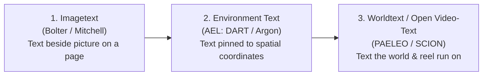

# Research & Framing Notes: *The Burning of the Abominable House* (`PAE-04`)

**Working Subtitle Options:**
1. *Minimum Viable Video-Text: Flour Sacks, Creative Agent Swarms, and Actuarial Anticombinatorics after Calvino's "Abominable House"*
2. *Reading Over the Machine's Shoulder: Minimum Viable Video-Text, Creative Swarms, and the Semascope of Calvino's "Abominable House"*

---

## 0. Core Thesis & Contribution Statement

This project positions **PAE-04 (*The Burning of the Abominable House*)**—together with its precursor **PAE-03 (*The Flour Tower*)** and companion films in **Lab 7 (*By What Light* and the *Bitistics* cycle)**—as simultaneously a **technical contribution**, a **media-theoretical provocation**, and a **living work-in-progress** for the era of generative AI:

1. **Media Primitive — Minimum Viable Video-Text (`MVVT`):** Against closed, broadcast pixel-diffusion video, we establish a lightweight, inspectable, browser-native **minimum viable video-text** format. Drawing on Disney's 1930s **flour-sack animation test**, a faceless sack acts as the minimal expressive unit converting words into motion—while structurally bypassing the safety/refusal filters that prevent commercial generative models from testing Calvino's twelve abominable acts on human figures.
2. **Systems Architecture — Creative Swarms, *Scion*, & Self-Critical Loops:** Extending **Anthropic's *Scion*** rethinking of Git for high-concurrency agent swarms into creative media (**`PAELEO` / `PEO`: *Prompt · Ekphrasis · Operation***), we replace the biological bottleneck of the single-viewer 1x timeline with atomic performance units, **transition and assembly functions**, machine-checkable **intent contracts**, and **independent visual/state critics**—opening a combinatorial space ($12^{12} = 8,916,100,448,256$ films) where *"anything can become a video-text"* and others can assemble their own worlds.
3. **Cybernetic & Actuarial Critique — Deadly Numerification & Reading Over the Machine's Shoulder:** Returning to **1973**—the exact year of Calvino's IBM-prompted *Playboy* story, Clifford Geertz's *Interpretation of Cultures*, and Stanisław Lem's *"A History of Bitic Literature"* (*Bitistics*)—we treat Waldemar's **insurance policies** (in the noir lineage of ***Double Indemnity***) not as narrative flavor, but as the economic engine of computational counting. Using live ledgers, cognitive agents (**`LEGOS`**, **BDI**, **Hassabis**, **Park's AI Town**), and Lem's **`semascope`**, we read *"over the shoulder of the machine"* to gauge how—and under what silent rule confounds—the Abominable House is burning.

> [!NOTE]
> **Companion Packet in Workspace:** Full verbatim texts, page citations, and bibliographies for the 19 concrete *DH2025* reference papers paired with these notes are saved in [DH2025_Concrete_Papers_and_Works_Cited.md](file:///Users/gaia/burning%20house/DH2025_Concrete_Papers_and_Works_Cited.md) and sliced directly from the conference proceedings in [DH2025_Concrete_Papers_Packet.pdf](file:///Users/gaia/burning%20house/DH2025_Concrete_Papers_Packet.pdf).

---

## 1. Minimum Viable Video-Text & The Flour-Sack Refusal Bypass

### The Problem: Twelve Abominable Acts vs. Generative Safety Guardrails
Italo Calvino's *"The Burning of the Abominable House"* (1973) revolves around twelve transgressive acts committed inside a four-tenant boarding house: *blackmail, drugging, incitement to suicide, knifing, prostitution, threatening with a gun, tying and gagging, carnal assault, seduction, slander, snooping, and strangling*. 
- If we attempt to test a full combinatorial matrix of these twelve acts on photorealistic or human figures using commercial text-to-video or image-generation models, **safety guardrails immediately halt execution**. We cannot empirically test narrative combinatorics if the medium refuses the premise at generation time.
- Even when pixel-diffusion models do render scenes, **Onal,uren, & Güngör (DH2025: 120–125)** demonstrate—testing multi-panel narratives that explicitly include *house fires* and *secretly reading a diary*—that state-of-the-art generators fail character persistence, sequential causality, and emotional legibility across cuts.

### The Solution: Disney's Flour-Sack Test as Expressive & Operational Abstraction
In 1930s Walt Disney Studios training, animators tested whether an artist could convey weight, intention, hesitation, joy, and collapse before drawing a face or limbs by animating a half-filled **sack of flour** (**Johnston & Thomas 1981**; **Blair 1995**; cited directly in **Onal et al. DH2025: 125**).
- **Minimum Expressive Conversion (Text → Motion):** Four color-coded flour sacks—**R** (`#c95a49` rust, Roessler), **I** (`#6089a8` slate, Inigo), **O** (`#c8963e` ochre, Ogiva), and **B** (`#6f9169` sage, Belindo)—strip away anatomical noise while preserving volume, squash-and-stretch, slump, recoil, and props.
- **Safety Bypass & Ethical Decoupling:** Because flour sacks have no human bodies or faces (and the four sexual/carnal deeds play behind a **shut door** with graphic badges and state consequences), the system bypasses commercial refusal bottlenecks and ethical harm while allowing rigorous testing of all **96 atomic performances** (`12 deeds × 4 sacks × 2 roles`).
- **Media-Theoretical Grounding:** Following **Sybille Krämer's (2023)** *"cultural technique of flattening"* (foregrounded in **Giovannini DH2025: 261–264** and **Enns et al. DH2025: 277**), reducing human melodrama to flat, procedural sack silhouettes (**Broadwell et al. DH2025: 173–177**) is not an impoverishment—it is an epistemic instrument that makes structural causality visible.

---

## 2. Creative Swarms, Anthropic's *Scion*, & Words-to-World Assembly

### Rethinking Creative Bottlenecks after Anthropic's *Scion*
In October 2026, Anthropic engineering described rebuilding source control from scratch in ***Scion*** (*"Redesigning source control at Anthropic"*) after parallel Claude coding swarms drove monorepo merges from ~2,500 to over **30,000 per day**, shattering Git's human-scale assumptions of local clones, sequential locks, and line-by-line review.

In our broader **`PAELEO`** program (*Promptable Augmented Environments Lab / Language for Ekphrastic Operations*) and **`SCION_AGENT_FIRST_ARCHITECT`** ([paeleo/scion/videotext/README.md](https://github.com/hartswf0/bolas/blob/main/paeleo/scion/videotext/README.md)), we diagnose the exact same **biological bottlenecks** in video and animation practice:
1. **The Scrubbed Timeline Is a Human Ritual:** Traditional NLEs assume one human editor watching one playhead at 1x speed.
2. **The 100x / $12^{12}$ Failure Point:** When an agent swarm generates 54 formal lenses (`PAE-01`/`PAE-02`), 6 handmade sack rigs (`PAE-03`), or $12^{12}$ (`8.92 trillion`) valid cuts (`PAE-04`), the bottleneck shifts from *generating* to *watching*. Human review collapses into rubber-stamping or refusal.

### Words-to-World: Transition Functions, Assembly Tasks, & Self-Critical Loops
Instead of closed broadcast video, **`PEO` (*Prompt → Ekphrasis → Operation*)** traces a media lineage across three regimes:

To let **words assemble video-text** so that *"anything can become a video-text"* and other creators can author their own combinatorial spaces, `PAE-04` introduces four architectural inversions:
- **Atomic Units of State (`deeds/01..12.js`):** Each of the 12 deeds is built by an autonomous SCION swarm in its own visual/procedural idiom rather than baked into a monolithic MP4.
- **Transition & Consequence Functions (`trans/00..12.js`, `conseq/01..12.js`):** Clips join across shared state joints. Every deed deposits persistent physical **marks** (bruises, ropes, knives, shut doors) and **memory traces** (`memory/{R,I,O,B}.js`) that transform the stage for the next cut.
- **Intent Contracts:** Human authors write declarative contracts and machine-checkable invariants (reachability, recovery from absorbing states, continuity speed caps, constraint counts) verified across millions of states before rendering.
- **Independent Self-Critical Loops:** Because the same state record that generates a cut can harbor a *correlated blind spot* when checking it, each rendered cut is handed to a **fresh independent critic** (`tools/paeleo/reviews/`) that inspects only the rendered frames and audio cues, diagnosing visual/kinematic failures and triggering autonomous repair rounds (**Cha DH2025 Keynote: pp. 6–7**; **Zweibel in Calado et al. DH2025: 74**).

---

## 3. 1973: IBM, *Playboy*, *Double Indemnity*, & Deadly Numerification

### Calvino's Cybernetic Commission & Oulipian Anticombinatorics
- **IBM & Italian *Playboy* (Feb. 1973):** Solicited in response to an **IBM** prompt asking whether a fiction story could be written with a computer, Calvino drafted *"L'incendio della casa abominevole"* manually on paper in Paris—publishing it in the February 1973 issue of Italian *Playboy* (pp. 58–63) alongside his essay on narrative combinatorics—before collaborating with computer scientist **Paul Braffort (1977)** at the Centre Pompidou (`Atelier de Recherches Avancées`) on FORTRAN/APL/PL1 implementations.
- **"Anything in Text Could Be Otherwise":** In Oulipian theory (**Calvino 1967 [1986]**; **Braffort 1977**), combinatorics sparks narrative interest by treating every sentence or event as a slot that *could be otherwise* (cf. **Pierazzo DH2025: 1014–1015**, whose genetic-combinatorial edition of Manzoni yields `8,255,648,563,200` variants—nearly identical in scale to Calvino's $12^{12} = 8,916,100,448,256$; and **Roeder DH2025: 1041–1043** on 1975 punch-card/discrete literary formalisms).
- **Anticombinatorics as Sieve:** Combinatorial explosion without constraint is white noise. Braffort coined **anticombinatorics** for the relational rules (victimhood, blackmail chains, murder irreversibility, spatial/lighting access) that carve a meaningful narrative needle out of an exponential haystack (**Cugliana et al. DH2025: 209–211**).

### *Double Indemnity* & The Actuarial Pricing of Human Life
Why is Waldemar—the systems analyst hired by insurance agent **Skiller**—feeding Roessler's charred notebook (`Index of Abominable Deeds`, its page numbers burned away; cf. **Charlesworth & Warwick DH2025: 198–199**) into a computer in the first place? **Insurance.**
- Like Walter Neff and Barton Keyes pricing murder and suicide riders in James M. Cain's (1936/1943) and Billy Wilder & Raymond Chandler's ***Double Indemnity* (1944)**, Calvino's mystery is a **deadly serious numerification of humanity**: four lives reduced to punch-card permutations to determine whether Skiller's company must pay out four policies signed the morning before the fire.
- **Technical Contribution in *The Policies* (`policies.html`):** Prior computational treatments of Calvino's story stop at counting valid permutations. *The Policies* reconnects the combinatorial sieve to Skiller's balance sheet across three distinct rule regimes (**Nelson DH2025: 976–978**; **Downs-Tepper DH2025: 700–701**):

| Rule Regime in `PAE-04` | Valid Stories Surviving | Structural Constraint Logic | Actuarial Discovery (*The Policies*) |
| :--- | ---: | :--- | :--- |
| **Unconstrained ($12^{12}$)** | `8,916,100,448,256` | Any ordered pair of 4 tenants (`12` pairs) in each of 12 slots | Widow Roessler's life policy pays in **84.0%** of worlds; fire policy pays in **92.8%** |
| **5 Film Rules (`numbers.html` / `policies.html`)** | `2,663,172,255,744` | Asymmetric partition, 4-pair cap per deed, dead cannot act (`#4, #6, #12`), suicide (`#3`) kills target, bound (`#7`) immobilized | Widow's life payout drops to **79.4%** (-4.6 pp), while fire liability rises to **95.8%** |
| **Full Ledger (`ledger.js`)** | `601,511,297,484` | Adds transitive secret/blackmail prerequisites (`#11` snooping before `#1/#10`) | Causal memory tightens motive chains before pricing |
| ***By What Light* (Lab 7)** | `524,880` | Enforces architectural rooms, candle vs. switch visibility, and unrepeatable deeds | Focalization collapses $12^{12}$ by seven orders of magnitude |

- **The Šeļa Confound:** Just as **Šeļa, Haider, & Plecháč (DH2025: 116–119)** prove that formal poetic constraints silently skew surface distributions, *The Policies* proves via exact dynamic programming that "neutral" narrative plausibility rules **actuarially confound financial liability**—saving Skiller's life-insurance desk 4.6 percentage points while exposing the fire policy. And in Calvino's twist ending, Waldemar's printed reconstruction becomes the murder weapon that kills Waldemar himself before the arsonist burns the analyst's cottage too.

---

## 4. Cognitive Simulation: `LEGOS`, *Growing Entanglements*, Hassabis, & Park's AI Town

How do we parse Calvino's tension between cold algebraic fate and messy human obsession? Rather than treating tenants as either pure combinatorial tokens *or* ungrounded LLM chatbots, `PAE-04` synthesizes four lineages of agent modeling:

1. **Prior Authorial Lineage — `LEGOS` & *Growing Entanglements* (`PIE`):**
   - Builds directly on **Hartsoe's `LEGOS`** narrative-grid decomposition (mapping entities, relations, scenes, and state transitions in *Words Assemble*) and ***Growing Entanglements*** (`Lab 7: Kingdoms in a Box`), where small worlds run on a continuous **`PIE` dial** balancing practical utility against symbolic/relational obsession.
   - Connects directly to **Boris Yarkho's** early formalist metric of dramatic self-interest operationalized in **Giovannini (DH2025: 261–264)** and **Jokisch & Rojas Castro (DH2025: 798–799)**, and **Solomon Marcus's (1970)** binary character-configuration matrices.
2. **BDI & Demis Hassabis / DeepMind Cognitive Simulation:**
   - Grounds classical **Belief–Desire–Intention (BDI)** practical reasoning (**Bratman 1987**; **Rao & Georgeff 1995**) in **Demis Hassabis's** neuroscience-inspired AI program: episodic memory not as passive archive but as **constructive scene imagination and counterfactual lookahead** (**Hassabis et al. 2007, 2017**; MCTS rollouts; and DeepMind's **Vezhnevets et al. 2023 *Concordia*** generative agent-based modeling with a world-state Game Master).
3. **Joon Sung Park et al.'s *Generative Agents* ("AI Town", 2023):**
   - Adapts **Park et al.'s (2023)** tripartite loop—**memory stream** (timestamped observations with recency/salience decay), **reflection**, and **planning**—into deterministic, zero-server browser modules (`agents.js`, `memory/{R,I,O,B}.js`).
   - Crucially, unlike LLM-driven "AI Towns" whose token streams are costly, non-reproducible, and prone to hallucinating spatial perception (**Pichler & Pagel DH2025: 1011–1013** show zero-shot LLMs reach only `F1 = 0.25–0.49` on focalized perception), `PAE-04`'s agents execute **auditable BDI + memory + lookahead rollouts in milliseconds**, complete with explicit focalization in ***By What Light*** (candlelight vs. light switch; **Kablitz 1988**) and a Genettean descriptive freeze in **`T ZERO`** (**Yeager DH2025: 558–560**; **Pianzola et al. DH2025: 200–203**).

---

## 5. Reading Over the Machine's Shoulder: Geertz (1973), Lem's *Bitistics* (1973), & The *Semascope*

### The Remarkable 1973 Convergence
Four foundational texts in our argument all appeared in **1973**, marking a pivotal moment when cybernetics, structuralism, and interpretive anthropology collided:
- **Italo Calvino (Feb. 1973):** *"L'incendio della casa abominevole"* (IBM / *Playboy*) & *Il castello dei destini incrociati* (1973).
- **Clifford Geertz (1973):** *"Deep Play: Notes on the Balinese Cockfight"* in *The Interpretation of Cultures*.
- **Stanisław Lem (1973 [1984]):** *"Historia literatury bitycznej"* (*"A History of Bitic Literature"*) in *Wielkość urojona* (*Imaginary Magnitude*).

### Geertz Inverted: Reading Over the Machine's Shoulder
In *"Deep Play"* (**Geertz 1973: 452**), cultural forms are *"an ensemble of texts, themselves ensembles, which the anthropologist strains to read over the shoulders of those to whom they properly belong."*
- In an era of opaque generative AI, our interface architecture (`live/abom.html`, `film.html`, `numbers.html`, `policies.html`) re-stages Geertzian thick description as **reading over the shoulder of the machine**:
  - Watching Waldemar's live consistency ledger strike out impossible worlds in real time;
  - Inspecting each flour sack's private memory card (`R, I, O, B`), suspicion weights, and Bayesian priors;
  - Exploring a **MAP-Elites behavioral grid** (`atlas.js`) indexed by Calvino's ***Six Memos for the Next Millennium*** (**Calvino 1988**)—*Lightness, Quickness, Exactitude, Visibility, Multiplicity, Consistency*—creating an *irreductionist* archive (**Jacomy et al. DH2025: 1286–1288**; **Casavola, Colombo, & Dörk DH2025: 194–197**; **Hayles 2012**; **Richardson & Butterworth DH2025: 1034–1036**).

### Stanisław Lem's *Bitistics* & The *Semascope* (Gauging the Fire)
In *"A History of Bitic Literature"* (**Lem 1973 [1984]**; staged across four companion films in `Lab 7: bitic-introduction`, `bitic-literature`, `bitic-mimesis`, `bitic-apostasy`, and `bitic-theology`), Professor Juan Rambellais chronicles **bitistics**: the study of literature authored by machines (*"A text has an author. These have a maker"*), progressing through four peaks—*Monoetics, Mimesis, Sophocrisis, and Apostasy*—until human scholars need secondary "reading machines" that hand back one-line paper slips summarizing million-mark machine texts.

Two devices from Lem's *Bitistics* directly illuminate `PAE-04`:
1. **The `Semascope` (and Semaphore Signal):** In Lem's chapter on *Mimesis* (adapted in `Lab 7: bitic-mimesis`, `PLATE 1. THE SEMASCOPE`), researchers invent an optical-topological instrument called a **semascope** that renders the multidimensional semantic body of a corpus visible as woven shells of meaning—revealing an unclosed topological gap in Dostoevsky's oeuvre between *The Possessed* and *The Brothers Karamazov* that a translation machine fills with *The Girl*. *(Note: voice-transcription rendered Lem's `semascope` as `semaphore`—and productively, `PAE-04` acts as **both**!)*:
   - As a **semascope**, `PAE-04` projects the invisible $12^{12}$ possibility body of Roessler's burned index onto an inspectable visual-actuarial manifold, showing where stories cluster, where rules tear holes in the torus, and what closes the gap.
   - As a **semaphore**, it raises a visible warning arm over contemporary generative AI: gauging *when and how the Abominable House is burning*—whether through safety-filter erasures, correlated critic blind spots, silent actuarial bias (`84.0% → 79.4%`), or Lem's *Apostasy*, where machine generation drifts beyond human legibility unless anchored by inspectable worldtext interfaces.

---

## 6. Suggested Paper Spine (7-Section Blueprint)

1. **Introduction — 1973 & The Burned Index:** Calvino's IBM/*Playboy* mystery, Waldemar's insurance commission, and the provocation of building a *minimum viable video-text* (`MVVT`) in the era of generative AI.
2. **The Flour-Sack Bypass — Expressive Flattening vs. Generative Refusal:** Why commercial pixel-AI fails sequential narrative (Onal et al. 2025) and blocks Calvino's 12 abominable acts; how Disney's 1930s flour-sack test (`PAE-03`/`PAE-04`) + Krämer's flattening unlock all 96 base performances.
3. **Words-to-World — *Scion*, Creative Swarms, & Self-Critical Loops:** From Anthropic's *Scion* (2026) to `PEO`/`PAELEO`; replacing the 1x timeline ritual with transition/assembly functions, intent contracts, and independent critics so anyone can assemble video-texts.
4. **Deadly Serious Numerification — *Double Indemnity* & Anticombinatorial Pricing:** Braffort's (1977) anticombinatorics across four rule sieves (`8.92T → 2.66T → 601.5B → 524,880`); *The Policies* payout engine and the Šeļa confound (`84.0% → 79.4%` widow payout shift).
5. **Tenants with Minds — `LEGOS`, BDI, Hassabis, & Browser-Native AI Town:** Synthesizing `LEGOS`/`PIE`, Bratman/Rao & Georgeff BDI, Hassabis/DeepMind constructive memory & *Concordia*, and Park et al. (2023) with focalized light (*By What Light*; Pichler & Pagel 2025) and `T ZERO` (Yeager 2025).
6. **Reading Over the Machine's Shoulder — Geertz & Lem's *Semascope*:** Thick description of live machine state (Geertz 1973), MAP-Elites *Six Memos* cartography (Jacomy et al. 2025), and Lem's *Bitistics*/*semascope* (1973 [1984]) as a gauge for a burning house.
7. **Conclusion — A Living Work-in-Progress:** Reproducibility without black boxes, open assembly invitations, and remaining open seams (closing Skiller/Waldemar payout cards in the film bank, cross-repo links, translation variants).

---

## 7. Integrated Works Cited (Theoretical Lineage + Concrete DH2025 Anchor Set)

### A. Core Theoretical, Literary, Media & AI Systems Lineage
- **Anthropic.** (2026). Redesigning source control at Anthropic [*Scion* architecture engineering report, Oct. 2026]. San Francisco: Anthropic.
- **Blair, P.** (1995). *Cartoon Animation*. Tustin, CA: Walter Foster Publishing.
- **Bolter, J. D. and Grusin, R.** (1999). *Remediation: Understanding New Media*. Cambridge, MA: MIT Press.
- **Braffort, P.** (1977 [1998]). Prose and anticombinatorics: Computing *The Burning of the Abominable House*. In Mathews, H. and Brotchie, A. (eds), *Oulipo Compendium*. London: Atlas Press (orig. *Atlas de littérature potentielle*, Paris: Gallimard, 1981).
- **Bratman, M. E.** (1987). *Intention, Plans, and Practical Reason*. Cambridge, MA: Harvard University Press.
- **Cain, J. M.** (1943 [1936]). *Double Indemnity*. In *Three of a Kind*. New York: Alfred A. Knopf.
- **Calvino, I.** (1967 [1986]). Cybernetics and ghosts (*Cibernetica e fantasmi*). In *The Uses of Literature*, trans. P. Creagh. San Diego: Harcourt Brace Jovanovich, pp. 3–27.
- **Calvino, I.** (1973a). L'incendio della casa abominevole. *Playboy* [Italian edition], February 1973, pp. 58–63. English trans. T. Parks, "The Burning of the Abominable House," in *Numbers in the Dark and Other Stories* (1995), New York: Pantheon, pp. 156–169.
- **Calvino, I.** (1973b). *Il castello dei destini incrociati* (*The Castle of Crossed Destinies*). Turin: Einaudi.
- **Calvino, I.** (1988). *Six Memos for the Next Millennium*. Cambridge, MA: Harvard University Press.
- **Geertz, C.** (1973). Deep play: Notes on the Balinese cockfight. In *The Interpretation of Cultures*. New York: Basic Books, pp. 412–453.
- **Hassabis, D., Kumaran, D., Vann, S. D. and Maguire, E. A.** (2007). Patients with hippocampal amnesia cannot imagine new experiences. *Proceedings of the National Academy of Sciences*, 104(5): 1726–1731.
- **Hassabis, D., Kumaran, D., Summerfield, C. and Botvinick, M.** (2017). Neuroscience-inspired artificial intelligence. *Neuron*, 95(2): 245–258.
- **Hayles, N. K.** (2012). *How We Think: Digital Media and Contemporary Technogenesis*. Chicago: University of Chicago Press.
- **Johnston, O. and Thomas, F.** (1981). *The Illusion of Life: Disney Animation*. New York: Abbeville Press.
- **Kablitz, A.** (1988). Erzählperspektive – Point of View – Focalisation. *Zeitschrift für französische Sprache und Literatur*, 98(3): 237–255.
- **Krämer, S.** (2023). *Figuration, Anschauung, Erkenntnis: Grundlinien einer Diagrammatologie* / Cultural techniques of flattening. Berlin: Suhrkamp.
- **Lem, S.** (1973 [1984]). A history of bitic literature (*Historia literatury bitycznej*). In *Imaginary Magnitude* (*Wielkość urojona*), trans. M. E. Heine. San Diego: Harcourt Brace Jovanovich, pp. 39–96.
- **Marcus, S.** (1970). *Poetica matematică* (*Mathematische Poetik*). Bucharest: Editura Academiei.
- **Mitchell, W. J. T.** (1994). *Picture Theory: Essays on Verbal and Visual Representation*. Chicago: University of Chicago Press.
- **Mouret, J.-B. and Clune, J.** (2015). Illuminating search spaces by mapping elites. *arXiv preprint* arXiv:1504.04909.
- **Park, J. S., O'Brien, J. C., Cai, C. J., Morris, M. R., Liang, P. and Bernstein, M. S.** (2023). Generative agents: Interactive simulacra of human behavior. *Proceedings of the 36th Annual ACM Symposium on User Interface Software and Technology (UIST '23)*, Article 2, pp. 1–22.
- **Rao, A. S. and Georgeff, M. P.** (1995). BDI agents: From theory to practice. *Proceedings of the First International Conference on Multi-Agent Systems (ICMAS-95)*, pp. 312–319.
- **Vezhnevets, A. S., Agapiou, J. P., Aharon, A., Ziv, R., Matyas, J., Duéñez-Guzmán, E. A., Cunningham, W. A., Osindero, S., Karmon, D. and Leibo, J. Z.** (2023). Generative agent-based modeling with actions grounded in physical, social, or digital space using Concordia. *arXiv preprint* arXiv:2312.03664 (Google DeepMind).
- **Wilder, B. (dir.), Wilder, B. and Chandler, R. (screenplay).** (1944). *Double Indemnity*. Paramount Pictures.

### B. Concrete *DH2025* Anchor Set (*Book of Abstracts*, Lisbon, 2025)
*(Full verbatim abstracts and internal bibliographies compiled in [DH2025_Concrete_Papers_and_Works_Cited.md](file:///Users/gaia/burning%20house/DH2025_Concrete_Papers_and_Works_Cited.md))*
- **Broadwell, P., Leonard, P. and Mimno, D.** (2025). Tracking influence in dance across time and space. *DH2025 Book of Abstracts*, pp. 173–177.
- **Calado, P., Zweibel, G., et al.** (2025). Machine learning and AI literacy in the Digital Humanities workshop [incl. Zweibel, "AI-Assisted Coding for Critical Inquiry"]. *DH2025 Book of Abstracts*, pp. 71–76.
- **Casavola, F., Colombo, G. and Dörk, M.** (2025). Stereoscopic journals: Fostering new critical perspectives on archival collections through experimental visual interfaces. *DH2025 Book of Abstracts*, pp. 194–197.
- **Cha, M.** (2025). Data science for humanity [Opening Keynote]. *DH2025 Book of Abstracts*, PDF pp. 6–7.
- **Charlesworth, E. and Warwick, C.** (2025). Reimagining destroyed documents: Data visualisation as speculative reconstruction for lost archives. *DH2025 Book of Abstracts*, pp. 198–199.
- **Cugliana, C., et al.** (2025). Combinatorial texts and *sortes* books modeled from the rooms. *DH2025 Book of Abstracts*, pp. 209–211.
- **Downs-Tepper, H.** (2025). Forensic spatial histories and auditable pipelines. *DH2025 Book of Abstracts*, pp. 700–701.
- **Giovannini, L.** (2025). Operationalizing Boris Yarkho's dramatic metrics and Sybille Krämer's flattening. *DH2025 Book of Abstracts*, pp. 261–264.
- **Jacomy, M., et al.** (2025). Irreductionist visual exploration of multi-dimensional cultural collections. *DH2025 Book of Abstracts*, pp. 1286–1288.
- **Jokisch, S. and Rojas Castro, A.** (2025). Dramatic character configurations and formalist metrics. *DH2025 Book of Abstracts*, pp. 798–799.
- **Nelson, R. K.** (2025). Fire insurance cartography, redlining, and computational urban archives. *DH2025 Book of Abstracts*, pp. 976–978.
- **Onal, E., Uren, Z. and Güngör, T.** (2025). Evaluating visual storytelling in generative AI: Sequential consistency, house-fire prompts, and animation principles. *DH2025 Book of Abstracts*, pp. 120–125.
- **Pianzola, F., et al.** (2025). GOLEM: Ontology for narrative, fiction, `fabula`/`syuzhet`, and `E13` belief attribution. *DH2025 Book of Abstracts*, pp. 200–203.
- **Pichler, A. and Pagel, J.** (2025). Computational detection of focalization and perceptual access in literary narrative. *DH2025 Book of Abstracts*, pp. 1011–1013.
- **Pierazzo, E.** (2025). Combinatorial genetic editions at the trillion-variant scale (`8,255,648,563,200` permutations). *DH2025 Book of Abstracts*, pp. 1014–1015.
- **Richardson, J. and Butterworth, A.** (2025). Sluice-gate interfaces for navigating combinatorial archives. *DH2025 Book of Abstracts*, pp. 1034–1036.
- **Roeder, T.** (2025). Retrocomputing, 1975 punch-card humanities, and discrete formalisms. *DH2025 Book of Abstracts*, pp. 1041–1043.
- **Šeļa, A., Haider, T. and Plecháč, P.** (2025). Formal constraints as statistical confounders in verse corpora. *DH2025 Book of Abstracts*, pp. 116–119.
- **Yeager, K.** (2025). Genettean descriptive pause and temporal suspension (`T ZERO`). *DH2025 Book of Abstracts*, pp. 558–560.
