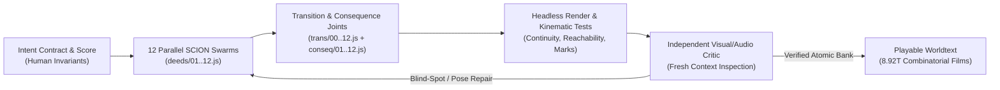

# Minimum Viable Video-Text: Flour Sacks, Creative Agent Swarms, and Actuarial Anticombinatorics in Calvino's *Abominable House*

**Document Role:** **Canonical Paper** (primary long-paper text alongside the 3-page short paper [`Reading_Over_the_Machines_Shoulder_DH2027.pdf`](./Reading_Over_the_Machines_Shoulder_DH2027.pdf); plain reading edition at [`read.html`](./read.html), interactive mechanism guide & slide deck at [`paeleo/abominable-house/live/guide.html`](./paeleo/abominable-house/live/guide.html), audited claims ledger at [`CLAIMS.md`](./CLAIMS.md), working source notes in [`Abominable_House_Framing_Notes.md`](./Abominable_House_Framing_Notes.md) and component spec in [`VTX01_MVVT_Research_Memo_and_Spec.md`](./VTX01_MVVT_Research_Memo_and_Spec.md))  
**Submission Category:** Long Paper (ADHO Digital Humanities / Computational Media & Generative AI)  
**Keywords:** minimum viable video-text, operative ekphrasis, creative agent swarms, Oulipian anticombinatorics, Italo Calvino, Stanisław Lem, computational narratology, actuarial humanities

> [!NOTE]
> **Anonymization & Length Toggle:** Self-references to `PAELEO`, `SCION`, `LEGOS`, and *Growing Entanglements* include bracketed `[Author]` tags so you can toggle cleanly between double-blind ADHO review and camera-ready submission. The body runs ~3,200 words (excluding tables and bibliography), fitting either a full conference paper or a *DHQ*/*Leonardo* article seed, and trims cleanly to 2,500 words if needed.

---

## 1. Introduction: 1973, a Burned Copybook, and Minimum Viable Video-Text

In February 1973, responding to an **IBM** inquiry asking how far a work of fiction could be written with a computer (**Esther Calvino 1995**; **Braffort 1977 [1998]**), Italo Calvino published *"L'incendio della casa abominevole"* (*"The Burning of the Abominable House"*) in the Italian edition of *Playboy* (**Calvino 1973a**). Four tenants perish when a boarding house burns to the ground: the widow landlady Roessler (`R`), her ex-model daughter Ogiva (`O`), the fallen young aristocrat Inigo (`I`), and the Uzbek wrestler Belindo Kid (`B`). Found in the ashes is a charred notebook titled *An Index of Abominable Deeds Committed in This House*, listing twelve crimes—*blackmail, drugging, incitement to suicide, knifing, prostitution, threatening with a gun, tying and gagging, carnal assault, seduction, slander, snooping,* and *strangling*—whose page numbers and perpetrators have burned away. Hired by the insurance agent Skiller, the computer programmer Waldemar encodes the twelve acts as ordered pairs among the four tenants. Because each of the twelve slots admits $4 \times 3 = 12$ perpetrator–victim pairs, the burned copybook opens onto $12^{12} = 8,916,100,448,256$ possible histories (a figure misprinted across editions as `8,874,296,672,256` and miscopied online as `874,296,672,256`, making exact verification an immediate philological act).

Notably, **1973** saw the simultaneous publication of four works that prefigure our contemporary predicament with generative AI: Calvino's *"Abominable House"* (**Calvino 1973a**), his tarot combinatorics in *Il castello dei destini incrociati* (**Calvino 1973b**), Clifford Geertz's *The Interpretation of Cultures*—which defined cultural analysis as straining to read texts *"over the shoulders of those to whom they properly belong"* (**Geertz 1973: 452**)—and the first Polish edition of Stanisław Lem's *Wielkość urojona* (Warsaw: Czytelnik, 1973; English trans. *Imaginary Magnitude*, **Lem 1973 [1984]**), whose *"History of Bitic Literature"* founded **bitistics**, the study of non-human literature written by machines. Half a century later, Digital Humanities confronts the practical fulfillment of that cybernetic horizon: massive generative models promise "words-to-video" synthesis yet lock scholars out of causal state, collapse sequential narrative coherence (**Onal, Uren, and Güngör 2025: 120–125**), cannot responsibly stage transgressive literary premises on human likenesses, and overwhelm human review when agent swarms generate thousands of candidate cuts.

This paper presents **`PAE-04` (*The Burning of the Abominable House*)**, an open-source suite of three algorithmic films, six live browser instruments (*Twelve to the Twelfth*, *The Deed Bank*, *The Film Bank*, *The Array*, *The Policies*, and *The Whole House*), the two-sack counterfactual benchmark **`VTX-0.1`**, and companion classroom films (*By What Light* and the *Bitistics* cycle) developed within `[Author]`'s **`PAELEO`** program (*Promptable Augmented Environments Lab / Language for Ekphrastic Operations*). Across the suite, one question—*which of the $12^{12}$ stories happened?*—receives five operational answers: **count** (`numbers.html`), **sieve** (`ledger.js`), **decide** (`agents.js`), **watch** (`film.html`, `array.html`, *By What Light*), and **price** (`policies.html`). Together, they establish three contributions:

1. **Minimum Viable Video-Text (`MVVT`) & Flour-Sack Abstraction:** Adapting Walt Disney Studios' 1930s **flour-sack animation test** (**Johnston and Thomas 1981**; **Blair 1995**), we establish a lightweight, procedural format for converting text into expressive motion graphics—preserving posture, timing, and causal legibility while withdrawing the human body so Calvino's twelve abominable acts can be tested and screened responsibly.
2. **Creative Agent Swarms after *Scion*:** Taking **Anthropic's (2026) *Scion*** rethinking of Git for high-concurrency coding swarms as an architectural analogy for media authoring, we replace the biological bottleneck of the single-viewer 1x timeline with atomic performance modules, **transition and assembly functions**, machine-checkable **intent contracts**, and **independent self-critical loops** so that words assemble playable *worldtexts* and others can author their own combinatorial cinema.
3. **Actuarial Anticombinatorics & Reading Over the Machine's Shoulder:** Reconnecting Oulipian anticombinatorics (**Braffort 1977 [1998]**) to Waldemar's **insurance contracts** (in the noir tradition of ***Double Indemnity***; **Cain 1943 [1936]**; **Wilder and Chandler 1944**), deterministic cognitive agents (**`LEGOS`**, **BDI**, **Hassabis**, **Park et al. 2023**), Geertzian thick description (**Geertz 1973**), and Lem's **`semascope`** (**Lem 1973 [1984]**), we expose how seemingly neutral plausibility rules silently confound financial liability (`84.0% → 79.4%`)—offering a live instrument to gauge how the Abominable House is burning.

---

## 2. Minimum Viable Video-Text and the Flour-Sack Abstraction

Why build a **minimum viable video-text** (`MVVT`) rather than prompting commercial text-to-video diffusion models? Our work encountered two hard boundaries—one narrative-kinematic, one ethical and representational—that expose deep limits in pixel-first generative AI.

First, commercial image and video generators remain structurally unsuited to combinatorial narrative testing. Evaluating state-of-the-art generators across multi-panel visual stories—including prompts depicting *house fires* and *secretly reading a diary* that uncannily mirror Calvino's plot—**Onal, Uren, and Güngör (2025: 120–125)** demonstrate persistent failures in character identity, spatial continuity, causal staging, and emotional legibility, explicitly invoking classical animation principles from Disney's *The Illusion of Life* (**Johnston and Thomas 1981**) and **Blair (1995)**. Second, Calvino's premise comprises **twelve abominable acts**: knifing, strangling, gun threats, drugging, tying and gagging, incitement to suicide, blackmail, prostitution, seduction, slander, snooping, and carnal assault. Generating or screening a systematic combinatorial matrix of those twelve violent and sexual acts on human figures is neither ethically responsible nor workable as an open classroom and scholarly testbed.

To test the premise responsibly, inspectably, and expressively, we turned—first in **`PAE-03` (*The Flour Tower*)**, then in the two-sack counterfactual **`VTX-0.1`**, and at full combinatorial scale in **`PAE-04`**—to the **1930s Disney flour-sack test** (**Johnston and Thomas 1981**). Before novice animators were permitted to draw faces, hands, or dialogue, they had to make a half-filled sack of flour convey weight, intention, hesitation, guilt, and collapse through volume, posture, and timing alone. In `PAE-04`'s deed bank and film bank (`player.html`, `film.html`, `array.html`), the four boarding-house tenants become color-coded flour sacks rendered procedurally on an HTML5 canvas: Widow Roessler in deep claret (`#6e3a33`; dark watch register `#c67a6e`), Belindo Kid in charcoal (`#2a2622` / `#a39b8e`), Inigo in pale straw (`#c9b089` / `#d4b67e`), and Ogiva in violet (`#7a3b8f` / `#b583c8`), while the two-sack `VTX-0.1` workbench (`vtx01_build/viewer/`) uses a high-contrast inspection palette of rust (`#c95a49`), slate (`#6089a8`), ochre (`#c8963e`), and sage (`#6f9169`). For the four sexual or carnal deeds (`#5` prostitution, `#8` assault, `#9` seduction, and `#1` blackmail's compromising staging), performance withdraws behind a **shut architectural door or curtain** accompanied by prop traces and persistent state consequences, withholding graphic harm without erasing structural slots from the narrative algebra.

The flour sack thus performs a double maneuver. Practically, withdrawing the human body makes the entire combinatorial testbench playable and shareable: *The Deed Bank* (`player.html`) stages all **144 distinct ordered-pair shots** (`12 deeds × 12 ordered pairs`), built from **96 individual sack-role performances** (`12 deeds × 4 sacks × 2 roles`). Theoretically, it exemplifies what Sybille Krämer calls the *"cultural technique of flattening"* (**Krämer 2023**, operationalized for dramatic corpora by **Giovannini 2025: 261–264**): deliberate reduction to two-dimensional procedural silhouettes (**Broadwell, Leonard, and Mimno 2025: 173–177**) strips away pixel noise so that posture, timing, and causal state become mathematically legible.

---

## 3. Prompting Creative Swarms: From Anthropic's *Scion* to Words-to-World Assembly

The flour-sack test belongs to a larger investigation into creative bottlenecks when authoring shifts from solitary human timelines to multi-agent swarms. On 13 October 2026, Anthropic engineering documented rebuilding version control from the ground up in ***Scion*** (*"Redesigning source control at Anthropic"*; **Anthropic 2026**) after parallel coding swarms pushed daily monorepo merges from ~2,500 (May 2026) to over **30,000 per day** (September 2026). Anthropic's proprietary monorepo system is not public and is unaffiliated with our prompt compiler of the same name, but its diagnosis of human-scale Git rituals—full local clones, sequential branch locks, and line-by-line human diff reading—provides a precise architectural analogy.

Within **`PAELEO`** and our **`SCION_AGENT_FIRST_ARCHITECT`** specification (`[Author]`), we identify the exact equivalent **biological artifacts** inside video and animation tooling:
- **The Scrubbed Timeline Is a Biological Ritual:** Conventional non-linear editors assume a single human viewer inspecting a single playhead at 1x clock speed.
- **The 100x / $12^{12}$ Failure Point:** Once creative swarms generate 54 formal animation lenses (`PAE-01`/`PAE-02`), 6 bottom-up sack rigs (`PAE-03`), or $12^{12}$ candidate films (`PAE-04`), the bottleneck moves from *cutting* to *watching*. Human review degenerates into rubber-stamping or blanket refusal.

To overcome this bottleneck, **`PEO` (*Prompt · Ekphrasis · Operation*)** reframes media history across three regimes of text-image coupling:
1. **Imagetext** (**Mitchell 1994**; **Bolter and Grusin 1999**): text remediating image on a flat page or screen.
2. **Environment Text**: text anchored to spatial coordinates in augmented and locative environments.
3. **Worldtext / Open Video-Text**: executable text that generates, governs, and re-assembles a simulated world. Where legacy broadcast video is a closed timeline meant only to be watched, **Minimum Viable Video-Text (`MVVT`)** turns video into an open, word-assembled language game where *"anything can become a video-text."*

In `PAE-04`, twelve autonomous `SCION` agent swarms authored the twelve abominable deeds as independent procedural modules (`deeds/01-blackmail.js` through `deeds/12-strangling.js`), coordinated through four agent-first architectural inversions that exemplify **Cha's (2025: PDF pp. 6–7)** call for modular, task-specific AI workflows preserving human interpretive agency and **Zweibel's** critical-code audit pedagogy for browser-native JavaScript (**Calado et al. 2025: 74**):

1. **Atomic State Topology:** Monolithic timelines are replaced by addressable deed units parameterized by `(actor, victim, room, marks)`.
2. **Transition and Assembly Functions (`trans/00..12.js`, `conseq/01..12.js`):** Rather than hard cuts between unrelated clips, transition functions carry spatial momentum across deeds while consequence modules stamp cumulative physical **marks** (rope bindings, knife wounds, spilled powder, shut doors) and private **memories** (`memory/{R,I,O,B}.js`) onto the dollhouse stage. Any sequence of twelve words/pairs dynamically assembles a continuous film—inviting other creators and students to substitute new deeds, rules, or casts.
3. **Intent Verification Contracts:** Human authorship shifts from keyframing to writing machine-checkable invariants (every state reachable; no absorbing deadlocks across thousands of random operator rollouts; velocity continuity across thresholds).
4. **Independent Self-Critical Loops:** A crucial failure mode of agentic pipelines is the **correlated blind spot**: if the same structured scene record both generates a cut and verifies it, a mislabeled joint or awkward silhouette passes every automated test. Each swarm cut is therefore handed to a **fresh independent critic** (`tools/paeleo/reviews/`) that never sees the authoring notes—inspecting only rendered frames and synthesized NumPy/SciPy audio cues to catch visual pops, occluded props, or silent beats and trigger iterative self-repair.

---

## 4. Deadly Serious Numerification: IBM, *Double Indemnity*, and Actuarial Anticombinatorics

If `MVVT` and `SCION` swarms establish *how* $12^{12}$ films can be assembled, Calvino's 1973 text insists we ask *why* anyone is counting them. Behind its playful Oulipian facade—published between IBM punch cards and *Playboy* glossies (**Calvino 1973a**; **Roeder 2025: 1041–1043**)—*"The Burning of the Abominable House"* stages a **deadly serious numerification of humanity**.

In his 1967 lecture *"Cybernetics and Ghosts"* (**Calvino 1967 [1986]**) and his subsequent 1977 Centre Pompidou collaboration with Oulipo computer scientist **Paul Braffort (1977 [1998])**, Calvino explored the generative premise that *"anything in text could be otherwise."* Yet pure combinatorics quickly drowns narrative interest in exponential equivalence—a dilemma echoed at DH2025 by **Pierazzo (2025: 1014–1015)**, whose genetic edition of Manzoni's *I promessi sposi* generates `8,255,648,563,200` potential texts (virtually matching Calvino's `8,916,100,448,256`). Braffort therefore defined **anticombinatorics**: formal relational constraints that prune impossible histories from the burned archive (**Charlesworth and Warwick 2025: 198–199**; **Cugliana et al. 2025: 209–211**).

During development of `PAE-04`, however, auditing our own ecosystem revealed a critical omission: **money**. Just as Walter Neff and claims investigator Barton Keyes price murder, accident, and suicide riders in James M. Cain's (1943 [1936]) and Billy Wilder and Raymond Chandler's ***Double Indemnity* (1944)**, Waldemar is not counting stories for aesthetic amusement. On the morning before the fire, Skiller's insurance company issued **four policies** tied to the boarding house—each voided by a specific moral or criminal clause (such as suicide, arson, or mutual complicity). Prior computational analyses of Calvino's story stop at counting valid permutations; none priced Skiller's exposure.

To close this gap, ***The Whole House*** (`whole-house.html`) and ***The Policies*** (`policies.html`) place all four constraint regimes side by side and compute exact dynamic-programming payout probabilities across the entire $12^{12}$ state space (**Nelson 2025: 976–978**; **Downs-Tepper 2025: 700–701**):

| Constraint Regime in `PAE-04` | Exact Surviving Stories | Anticombinatorial Rules Enforced | Actuarial Discovery (*The Policies*) |
| :--- | ---: | :--- | :--- |
| **1. Unconstrained Space ($12^{12}$)** | `8,916,100,448,256` (`100%`) | 12 ordered pairs independently assigned across 12 slots | Widow Roessler's life policy pays in **84.0%** of worlds; fire policy pays in **92.8%** |
| **2. Five Film Rules (`numbers.html` / `policies.html`)** | `2,663,172,255,744` (`29.87%`) | Asymmetric class partition; max 4 deeds per pair; dead (`#4, #6, #12`) cannot act; incited suicide (`#3`) kills victim; bound (`#7`) immobilized | Widow's life payout falls to **79.4%** (-4.6 pp); fire liability rises to **95.8%** (+3.0 pp) |
| **3. Full Consistency Ledger (`ledger.js`)** | `601,511,297,484` (`6.75%`) | Adds transitive epistemic prerequisites (`#11` snooping required before `#1` blackmail or `#10` slander) | Causal memory restricts blackmail chains prior to pricing |
| **4. *By What Light* (`Lab 7`, Film 29)** | `524,880` (`0.0000059%`) | Adds room adjacency, candle vs. switch visibility, witness legibility, and non-repeating deeds | Architectural focalization collapses $12^{12}$ by seven orders of magnitude |

This exact pricing uncovers a striking **actuarial confound** that extends **Šeļa, Haider, and Plecháč's (2025: 116–119)** demonstration at DH2025 that formal poetic constraints act as silent statistical confounders on surface distributions. Imposing five seemingly neutral physical plausibility rules—chiefly that dead tenants cannot commit subsequent crimes and incitement to suicide terminates its target—Concentrates Roessler's survival trajectories into suicide-voided paths, silently saving Skiller's life-insurance desk **4.6 percentage points** (`84.0% → 79.4%`) while pushing fire-policy liability up to **95.8%**. Moreover, *The Policies* introduces a continuous slider modeling Calvino's dark metafictional twist—the probability that Roessler's copybook was **planted** to manipulate the investigation—before the story's final turn, in which Waldemar's own computer printout becomes part of a second crime scene where Waldemar himself dies and his cottage burns.

---

## 5. Tenants with Minds, Stages with Levers: `PIE`, `PLoT`, Barthes, BDI, and Kurosawa

Even after anticombinatorial sieving, `601.5 billion` ledger-consistent histories remain, and exposing raw diagnostic numbers without theoretical framing risks overwhelming the viewer. Contextualized step by step in our interactive **Field Guide and Slide Deck** (`paeleo/abominable-house/live/guide.html`), `PAE-04` synthesizes six cognitive and semiotic lineages inside client-side JavaScript (`ledger.js`, `story.js`, `agents.js`, `crossed.js`, `memory/{R,B,I,O}.js`):

1. **`LEGOS` and *Growing Entanglements* (`PIE`; `[Author] 2024`):** Builds directly on `[Author]`'s prior work in **`LEGOS`** (*Words Assemble*), which decomposes narrative worlds into structured entity-relation-scene grids, and ***Growing Entanglements: Captain Cook, cultural rationality, and seven small worlds*** (**Hartsoe 2024**), where small multi-agent worlds reframe the Sahlins–Obeyesekere debate through three explicit **`PIE` dials**: `P` (*Symbolic obligation ↔ Practical calculation*), `I` (*Collective house rumor ↔ Individual witness belief*), and `E` (softmax entropy temperature $\tau = 0.08 + 1.6E$). In literary history, this operationalizes Russian Formalist **Boris Yarkho's** quantitative index of dramatic self-interest (**Giovannini 2025: 261–264**; **Jokisch and Rojas Castro 2025: 798–799**) alongside **Solomon Marcus's (1970)** binary character-configuration matrices.
2. **Probabilistic Language of Thought (`PLoT`) and *The House of Dust*:** Treating every deed as an asymmetric tug-of-war match after **Goodman, Tenenbaum, and Gerstenberg (2015)**, each sack updates latent Gaussian estimates of `strength` and Kalman-filtered `danger` (`PLOT · tug-of-war update`), gated epistemically by **Knowles and Tenney's (1967)** four-axis ***House of Dust*** grammar (room, light level advanced by a rising fire clock from Deed IX, co-present witnesses, and persistent material traces; extended in ***By What Light***, `Lab 7`, Film 29, which collapses valid focalized histories to `524,880`, addressing the zero-shot LLM focalization failures documented by **Pichler and Pagel 2025: 1011–1013** on **Kablitz 1988**).
3. **Barthesian Mythologies and Stagecraft Levers:** Pairing quantitative `PLoT` strength with **Roland Barthes's (1957 [1972])** *"The World of Wrestling"* (*Mythologies*), each sack carries a 15-archetype profile (`MISER, IDOL, GENTLE GIANT, BRUTE, PREDATOR, VICTIM, SCAPEGOAT, CORPSE…`) that actively drives seven canvas compositing levers (`loom, weight, tempo, halo, shadow, shrink, grey`)—scaling predators larger, casting spotlights and diagonal shadows, and desaturating corpses.
4. **BDI, Hassabis Constructive Memory, and Park's Reflection Stream:** Classical **Belief–Desire–Intention (BDI)** committed plans (**Bratman 1987**; **Rao and Georgeff 1995**) are paired with **Demis Hassabis's** thesis on constructive episodic simulation (**Hassabis et al. 2007, 2017**; **Vezhnevets et al. 2023**) for MCTS lookahead (*The Most Likely Story*, `film 1,541,585,241,617`, `3 min 23 s`) and **Joon Sung Park et al.'s (2023)** timestamped **Observation / Reflection / Plan** stream (triggering syntheses when accumulated importance reaches `14`), structured compatibly with **GOLEM** belief states (**Pianzola et al. 2025: 200–203**). Pressing **`T ZERO`** triggers a Genettean descriptive pause (**Yeager 2025: 558–560**), displaying all twelve counterfactual branches.
5. **Inverse Planning (`THE AUDIENCE`) and Kurosawa's Lies (`THE LIES`):** Modeling reception via Bayesian Theory of Mind (**Baker, Saxe, and Tenenbaum 2009**) and **Inverse-Inverse Planning** (**Chandra et al. 2024**), `crossed.js` tracks `surprise`, `twist` (KL divergence across inferred plans), `suspense` (binary entropy over whether the next lethal deed kills), and dramatic `irony`, while checking all four personal strands in Calvino's *Castle of Crossed Destinies* tableau. Finally, after **Akira Kurosawa's (1982)** observation in *Something Like an Autobiography* that *Rashomon* portrays human egoism—our inability to survive without protective lies (*"Possession equals safety," "Strength makes me safe," "Nothing I do counts," "Being looked at is being safe"*)—`story.js` tracks which deed breaks each tenant's self-deception and computes geometric-mean modal believability (`PREPOSTEROUS` through `CERTAIN`).

---

## 6. Reading Over the Machine's Shoulder: Two Lenses on $12^{12}$ and Lem's *Semascope*

Because every calculation in `PAE-04` runs deterministically in the reader's browser with zero server black boxes, the suite transforms how humanists read algorithmic systems. Inverting **Clifford Geertz's (1973: 452)** famous characterization of ethnography—reading cultural texts *"over the shoulders of those to whom they properly belong"*—our split-register visual design (a dark theatrical **"watch" register** for *The Film Bank* and *The Deed Bank* paired with a warm archival **"read" register** for *Twelve to the Twelfth*, *The Policies*, *Field Guide*, and *Lab 7*) lets scholars **read over the shoulder of the machine** as it counts, sieves, remembers, and prices.

Because *"find kinds of film"* and *"see all paths without sampling"* require distinct cartographies (**Jacomy et al. 2025: 1286–1288**; **Casavola, Colombo, and Dörk 2025: 194–197**; **Richardson and Butterworth 2025: 1034–1036**), `PAE-04` pairs two complementary lenses on the 8.92-trillion space:
- **Lens 1 — The Exact Address Map (`array.html#address`):** Places every one of the $12^{12}$ films at an exact position with **zero sampling** inside a recursive $4 \times 3$ grid (`4` doers × `3` victims across twelve levels), colored by exact rule-survival or policy-payout shares (`50/63 = 79.37%` for Widow Roessler's life policy), equipped with **deed re-rooting** (turning *"Ogiva strangles the widow"* from scattered dust when strangling is innermost into one solid block when strangling is outermost), **132 single-deed Hamming neighbours**, and exact `BigInt` query counts.
- **Lens 2 — The Behaviour Map (`atlas.js` · *Six Memos* MAP-Elites):** Illuminates `6,030` sampled trajectories using **MAP-Elites** quality-diversity search (**Mouret and Clune 2015**) indexed along Calvino's ***Six Memos for the Next Millennium*** (**Calvino 1988**: *Exactitude, Multiplicity, Visibility*), preserving distinct structural species (**Hayles 2012**).

Finally, reading over the machine's shoulder brings Calvino's 1973 boarding house into direct conversation with **Stanisław Lem's 1973 *Bitistics*** (**Lem 1973 [1984]**; staged across five companion films in `Lab 7: bitic-introduction` through `bitic-theology`). Chronicling machine-authored literature from *Monoetics* and *Mimesis* to *Sophocrisis* and trans-human *Apostasy*, Lem's fictional collective *Juan Rambellais et al.* ("Introduction" to *A History of Bitic Literature, Volume I*, §B–C in Heine's 1984 translation) describes how H. Ellias and T. Semmelberg discovered that a machine-interpreted *"n-body of Abstractions"* *"can be seen as a whole if that abstract creation is put into the requisite electron appliance (a semascope)"*, appearing visually as a *"many-shelled, aperiodic, and variably synchronous mass, woven of 'burning threads'—that is, billions of 'significant curves'"* and inaugurating *"semascopy"* as *"a new aptitude for looking at the great intellectual totalities"* (**Lem 1973 [1984]: 39–96**, "Introduction," §§B–C; adapted in `Lab 7: bitic-mimesis`, `PLATE 1. THE SEMASCOPE`).

`PAE-04` operates simultaneously as **Lem's `semascope`** and as our own **warning semaphore** for the era of generative AI:
- As a **semascope**, it renders the invisible $12^{12}$ body of Roessler's burned copybook optically and actuarially inspectable—across *The Array*'s recursive $12^{12}$ address map and behaviour space, *The Numbers*, and *The Policies*—showing where formal rules tear holes in the narrative space and how light and memory close the gap.
- As a **semaphore**, it signals precisely *how the Abominable House is burning today*: when transgressive literary predicates cannot be responsibly tested without formal abstraction; when timeline editors choke on swarm concurrency; when correlated blind spots fool automated verifiers; when "neutral" formal constraints silently bias actuarial payouts (`84.0% → 79.4%`); and when black-box generation drifts toward Lem's *Apostasy*—a literature begun by humans in which humans can no longer read what is inside.

---

## 7. Conclusion: Provocation, Reproducibility, and a Living Work-in-Progress

Rather than presenting a closed monument, we offer `PAE-04` and `VTX-0.1` as a **test case, provocation, and living work-in-progress**. Technically, they demonstrate that browser-native **Minimum Viable Video-Text (`MVVT`)**, flour-sack procedural abstraction, and `SCION` self-critical swarms can assemble trillions of inspectable, reproducible narrative films without GPU lock-in. Critically, they recover the 1973 cybernetic insight of Calvino, Geertz, and Lem: computational form is never innocent of human obsession or actuarial capital.

True to Oulipian workshop practice, several seams remain deliberately open and documented on our presenter's hub (*The Whole House*) and claims ledger (`CLAIMS.md`):
1. **Unbriefed Blind Perceptual Ballots (`VTX-0.1`):** *The VTX-0.1 Viewer* (`vtx01_build/viewer/index.html?mode=blind_test`) ships a caption-free blind ballot testing whether unbriefed human viewers distinguish accidental steadying (`Case A`) from deliberate lamp-tipping (`Case B`) from sack kinematics alone; collecting and committing five to ten human ballots remains our first open empirical check (`C13`).
2. **Joining the Frame Narrative to the Film Bank:** Skiller, Waldemar, and the arsonist currently appear in *The First Film* (`1 min 36 s`) and row 13 of *The Deed Bank*; adding a dynamic closing card to *The Film Bank* displaying Skiller's four policy verdicts for whichever of the $12^{12}$ films just played will fuse the cinema directly to the balance sheet.
3. **Open Words-to-World Invitation:** Because `deeds/`, `trans/`, `conseq/`, and `ledger.js` communicate across clean state contracts, any researcher, animator, or classroom swarm can swap in twelve new verbs, rewrite the transition rules, and watch a new worldtext ignite.

---

## Works Cited

- **Anthropic.** (2026). Redesigning source control at Anthropic [*Scion* engineering post, 13 October 2026]. San Francisco: Anthropic. <https://www.anthropic.com/research/redesigning-source-control>.
- **Baker, C. L., Saxe, R. and Tenenbaum, J. B.** (2009). Action understanding as inverse planning. *Cognition*, 113(3): 329–349.
- **Barthes, R.** (1957 [1972]). The world of wrestling (*Le monde où l'on catche*). In *Mythologies*, trans. A. Lavers. New York: Hill and Wang, pp. 15–25.
- **Blair, P.** (1995). *Cartoon Animation*. Tustin, CA: Walter Foster Publishing.
- **Bolter, J. D. and Grusin, R.** (1999). *Remediation: Understanding New Media*. Cambridge, MA: MIT Press.
- **Braffort, P.** (1977 [1998]). Prose and anticombinatorics: Computing *The Burning of the Abominable House*. In Mathews, H. and Brotchie, A. (eds), *Oulipo Compendium*. London: Atlas Press (orig. *Atlas de littérature potentielle*, Paris: Gallimard, 1981).
- **Bratman, M. E.** (1987). *Intention, Plans, and Practical Reason*. Cambridge, MA: Harvard University Press.
- **Broadwell, P., Leonard, P. and Mimno, D.** (2025). Tracking influence in dance across time and space. *Digital Humanities 2025: Book of Abstracts*. Lisbon: ADHO / NOVA FCSH, pp. 173–177.
- **Cain, J. M.** (1943 [1936]). *Double Indemnity*. In *Three of a Kind*. New York: Alfred A. Knopf.
- **Calado, P., Zweibel, G., et al.** (2025). Machine learning and AI literacy in the Digital Humanities [incl. Zweibel, "AI-Assisted Coding for Critical Inquiry"]. *Digital Humanities 2025: Book of Abstracts*. Lisbon: ADHO / NOVA FCSH, pp. 71–76.
- **Calvino, E.** (1995). Introduction. In Calvino, I., *Numbers in the Dark and Other Stories*, trans. T. Parks. New York: Pantheon, pp. 1–4.
- **Calvino, I.** (1967 [1986]). Cybernetics and ghosts (*Cibernetica e fantasmi*). In *The Uses of Literature*, trans. P. Creagh. San Diego: Harcourt Brace Jovanovich, pp. 3–27.
- **Calvino, I.** (1973a). L'incendio della casa abominevole. *Playboy* [Italian edition], February 1973, pp. 58–63. English trans. T. Parks, "The Burning of the Abominable House," in *Numbers in the Dark and Other Stories* (1995), New York: Pantheon, pp. 156–169.
- **Calvino, I.** (1973b). *Il castello dei destini incrociati* (*The Castle of Crossed Destinies*). Turin: Einaudi.
- **Calvino, I.** (1988). *Six Memos for the Next Millennium*. Cambridge, MA: Harvard University Press.
- **Casavola, F., Colombo, G. and Dörk, M.** (2025). Stereoscopic journals: Fostering new critical perspectives on archival collections through experimental visual interfaces. *Digital Humanities 2025: Book of Abstracts*. Lisbon: ADHO / NOVA FCSH, pp. 194–197.
- **Cha, M.** (2025). Data science for humanity [Opening Keynote]. *Digital Humanities 2025: Book of Abstracts*. Lisbon: ADHO / NOVA FCSH, PDF pp. 6–7.
- **Chandra, K., Li, T.-M., Tenenbaum, J. B. and Ragan-Kelley, J.** (2024). Storytelling as inverse inverse planning. *Topics in Cognitive Science* / *Proceedings of the Annual Meeting of the Cognitive Science Society*.
- **Charlesworth, E. and Warwick, C.** (2025). Reimagining destroyed documents: Data visualisation as speculative reconstruction for lost archives. *Digital Humanities 2025: Book of Abstracts*. Lisbon: ADHO / NOVA FCSH, pp. 198–199.
- **Cugliana, C., et al.** (2025). Combinatorial texts and *sortes* books modeled from the rooms. *Digital Humanities 2025: Book of Abstracts*. Lisbon: ADHO / NOVA FCSH, pp. 209–211.
- **Downs-Tepper, H.** (2025). Forensic spatial histories and auditable pipelines. *Digital Humanities 2025: Book of Abstracts*. Lisbon: ADHO / NOVA FCSH, pp. 700–701.
- **Geertz, C.** (1973). Deep play: Notes on the Balinese cockfight. In *The Interpretation of Cultures*. New York: Basic Books, pp. 412–453.
- **Giovannini, L.** (2025). Operationalizing Boris Yarkho's dramatic metrics and Sybille Krämer's flattening. *Digital Humanities 2025: Book of Abstracts*. Lisbon: ADHO / NOVA FCSH, pp. 261–264.
- **Goodman, N. D., Tenenbaum, J. B. and Gerstenberg, T.** (2015). Concepts in a probabilistic language of thought. In Margolis, E. and Laurence, S. (eds), *The Conceptual Mind: New Directions in the Study of Concepts*. Cambridge, MA: MIT Press, pp. 623–653.
- **Hartsoe, W. [`[Author]`].** (2024). *Growing Entanglements: Captain Cook, cultural rationality, and seven small worlds* [*Probabilistic Cultural Systems Ontology*, Fall 2024]. <https://hartswf0.github.io/elsewhere/watson-hartsoe-site/aphoristic-social-models/index.html>
- **Hassabis, D., Kumaran, D., Vann, S. D. and Maguire, E. A.** (2007). Patients with hippocampal amnesia cannot imagine new experiences. *Proceedings of the National Academy of Sciences*, 104(5): 1726–1731.
- **Hassabis, D., Kumaran, D., Summerfield, C. and Botvinick, M.** (2017). Neuroscience-inspired artificial intelligence. *Neuron*, 95(2): 245–258.
- **Hayles, N. K.** (2012). *How We Think: Digital Media and Contemporary Technogenesis*. Chicago: University of Chicago Press.
- **Jacomy, M., et al.** (2025). Irreductionist visual exploration of multi-dimensional cultural collections. *Digital Humanities 2025: Book of Abstracts*. Lisbon: ADHO / NOVA FCSH, pp. 1286–1288.
- **Johnston, O. and Thomas, F.** (1981). *The Illusion of Life: Disney Animation*. New York: Abbeville Press.
- **Jokisch, S. and Rojas Castro, A.** (2025). Dramatic character configurations and formalist metrics. *Digital Humanities 2025: Book of Abstracts*. Lisbon: ADHO / NOVA FCSH, pp. 798–799.
- **Kablitz, A.** (1988). Erzählperspektive – Point of View – Focalisation. *Zeitschrift für französische Sprache und Literatur*, 98(3): 237–255.
- **Knowles, A. and Tenney, J.** (1967). *A House of Dust*. Cologne / New York: Gebrüder König / Something Else Press.
- **Krämer, S.** (2023). *Figuration, Anschauung, Erkenntnis: Grundlinien einer Diagrammatologie*. Berlin: Suhrkamp.
- **Kurosawa, A.** (1982). *Something Like an Autobiography*, trans. A. E. Bock. New York: Alfred A. Knopf.
- **Lem, S.** (1973 [1984]). Juan Rambellais et al., A history of bitic literature, Volume I (*Historia literatury bitycznej*). First Polish ed. in *Wielkość urojona*, Warsaw: Spółdzielnia Wydawnicza "Czytelnik", 1973 (170 pp.); English trans. M. E. Heine in *Imaginary Magnitude*, San Diego: Harcourt Brace Jovanovich (A Helen and Kurt Wolff Book), 1984, pp. 39–96.
- **Marcus, S.** (1970). *Poetica matematică* (*Mathematische Poetik*). Bucharest: Editura Academiei.
- **Mitchell, W. J. T.** (1994). *Picture Theory: Essays on Verbal and Visual Representation*. Chicago: University of Chicago Press.
- **Mouret, J.-B. and Clune, J.** (2015). Illuminating search spaces by mapping elites. *arXiv preprint* arXiv:1504.04909.
- **Nelson, R. K.** (2025). Fire insurance cartography, redlining, and computational urban archives. *Digital Humanities 2025: Book of Abstracts*. Lisbon: ADHO / NOVA FCSH, pp. 976–978.
- **Onal, E., Uren, Z. and Güngör, T.** (2025). Evaluating visual storytelling in generative AI: Sequential consistency and animation principles. *Digital Humanities 2025: Book of Abstracts*. Lisbon: ADHO / NOVA FCSH, pp. 120–125.
- **Park, J. S., O'Brien, J. C., Cai, C. J., Morris, M. R., Liang, P. and Bernstein, M. S.** (2023). Generative agents: Interactive simulacra of human behavior. *Proceedings of the 36th Annual ACM Symposium on User Interface Software and Technology (UIST '23)*, Article 2, pp. 1–22.
- **Pianzola, F., et al.** (2025). GOLEM: Ontology for narrative, fiction, and belief attribution. *Digital Humanities 2025: Book of Abstracts*. Lisbon: ADHO / NOVA FCSH, pp. 200–203.
- **Pichler, A. and Pagel, J.** (2025). Computational detection of focalization and perceptual access in literary narrative. *Digital Humanities 2025: Book of Abstracts*. Lisbon: ADHO / NOVA FCSH, pp. 1011–1013.
- **Pierazzo, E.** (2025). Combinatorial genetic editions at the trillion-variant scale. *Digital Humanities 2025: Book of Abstracts*. Lisbon: ADHO / NOVA FCSH, pp. 1014–1015.
- **Rao, A. S. and Georgeff, M. P.** (1995). BDI agents: From theory to practice. *Proceedings of the First International Conference on Multi-Agent Systems (ICMAS-95)*, pp. 312–319.
- **Richardson, J. and Butterworth, A.** (2025). Sluice-gate interfaces for navigating combinatorial archives. *Digital Humanities 2025: Book of Abstracts*. Lisbon: ADHO / NOVA FCSH, pp. 1034–1036.
- **Roeder, T.** (2025). Retrocomputing, 1975 punch-card humanities, and discrete formalisms. *Digital Humanities 2025: Book of Abstracts*. Lisbon: ADHO / NOVA FCSH, pp. 1041–1043.
- **Šeļa, A., Haider, T. and Plecháč, P.** (2025). Formal constraints as statistical confounders in verse corpora. *Digital Humanities 2025: Book of Abstracts*. Lisbon: ADHO / NOVA FCSH, pp. 116–119.
- **Vezhnevets, A. S., Agapiou, J. P., Aharon, A., Ziv, R., Matyas, J., Duéñez-Guzmán, E. A., Cunningham, W. A., Osindero, S., Karmon, D. and Leibo, J. Z.** (2023). Generative agent-based modeling with actions grounded in physical, social, or digital space using Concordia. *arXiv preprint* arXiv:2312.03664.
- **Wilder, B. (dir.), Wilder, B. and Chandler, R. (screenplay).** (1944). *Double Indemnity*. Paramount Pictures.
- **Yeager, K.** (2025). Genettean descriptive pause and temporal suspension. *Digital Humanities 2025: Book of Abstracts*. Lisbon: ADHO / NOVA FCSH, pp. 558–560.
