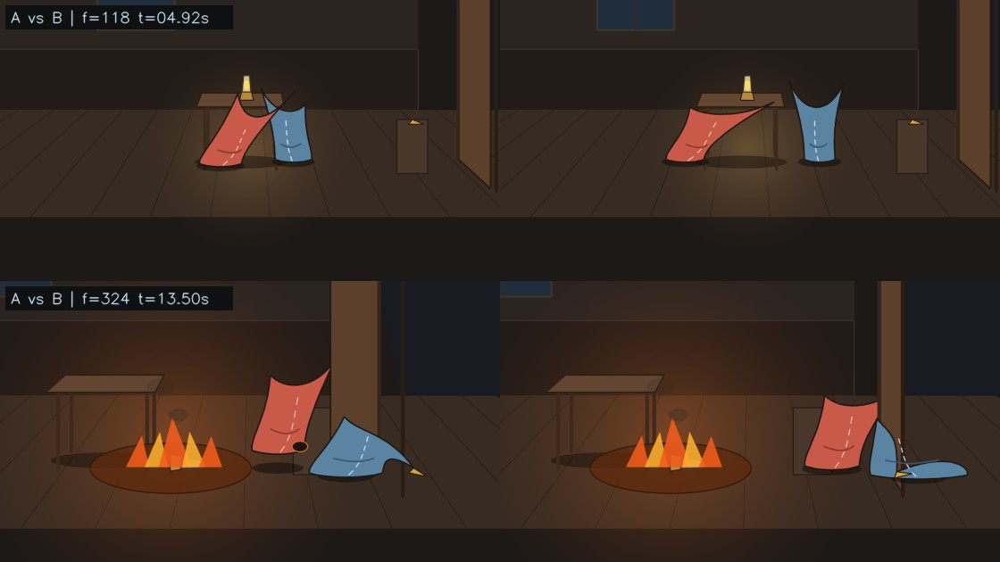
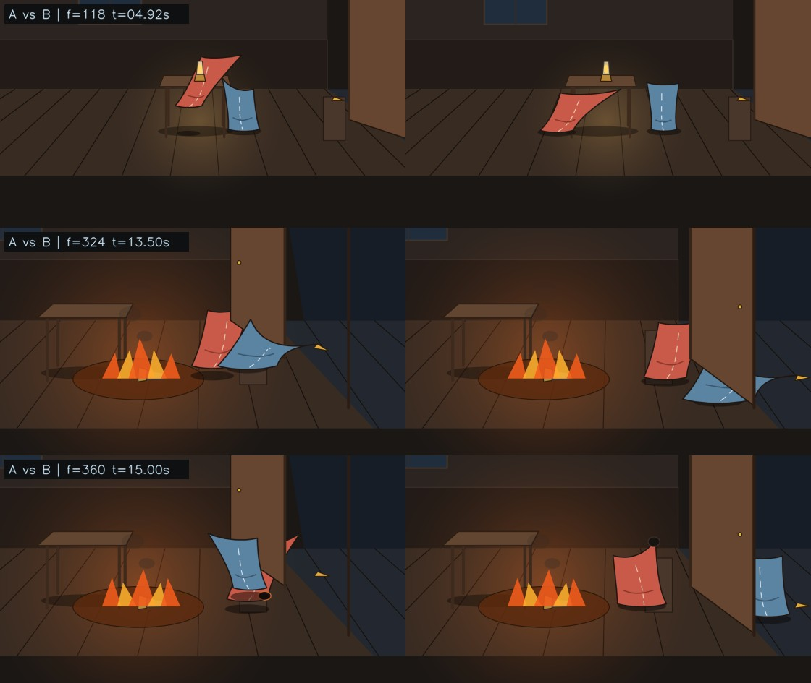

# Logline, Journal Entries 21–38, and What We Already Have

Standalone ruled-notebook HTML edition (preserving Entries `01–20` verbatim and adding Entries `21–38` in the same layout):
- Notebook page: [index.html](./Abominable_House_Journal_38/index.html)
- Portable archive: [Abominable_House_Journal_38.zip](./Abominable_House_Journal_38.zip)

---

## Part I · Loglines

### Core Logline
> **A burned boarding house leaves an index of twelve crimes, `8,916,100,448,256` possible histories, and four insurance policies waiting on who did what to whom; staged with faceless flour sacks in a bare, editable video-text where changing one line of intent re-runs the room, strips away verbal labels so weight and motion must testify on their own, and recalculates who gets paid.**

### Five Cuts by Venue

| Register | One-Sentence Cut |
| :--- | :--- |
| **Slide / Notebook Line** | Twelve crimes in a burned copybook, `12^12` stories, and faceless flour sacks acting out the difference between an accident and a claim. |
| **Screening / Exhibition** | After Italo Calvino's 1973 computer fable, four faceless flour sacks replay the `8.9 trillion` ways a boarding house might have burned—turning a 1930s studio weight test into an actuarial detective film where every changed motive alters the body, the room, and the payout. |
| **Paper / Systems (`MVVT`)** | Using Calvino's *The Burning of the Abominable House* and the Disney flour-sack test, we build a minimum viable video-text in which textual propositions, relational object memories, rendered movement, and insurance verdicts stay causally linked under single-line counterfactual edits—and separate what the file knows from what a witness can see. |
| **Theory / Media Spine (`zettle.md` cut)** | Stripping rendered space down to faceless flour sacks and mute props clears Barthes's reality-effect clutter and suspends verbal overshadowing, turning Calvino's anticombinatoric murder puzzle into a negative-fortress test of whether non-verbal movement alone can carry causal and moral weight. |
| **Two-Sack Proof (`VTX-0.1`)** | Two faceless flour sacks, one oil lamp, and the same fire: seventy-seven identical frames diverge on one changed goal—reaching to steady a neighbor versus striking the lamp—to test whether silhouette and weight alone can convict or indemnify. |

---

## Part II · Journal Toward a Paper (Entries 21–38)

> [!NOTE]
> Following the four rules of [Abominable House Journal.zip](./Abominable%20House%20Journal.zip), each entry below records **one concrete thing**, displays its **exact exhibit and locator**, marks **what was not checked**, and carries one of the four badges (`MEASURED`, `STRUCTURAL`, `REPORTED`, `UNKNOWN`). Entries `21–32` come from `DH2025`, `vtx01_build`, `PAE-03/04`, and `Lab 7`; Entries `33–38` come from opening [zettle.md](./zettle.md) and [xzet.md](./xzet.md).

---

### `21` · `10 Nov 2026 · 20:56 · DH2025` — *Another eight trillion*
A search of [BoA_DH2025.pdf](./BoA_DH2025.pdf) turns up another Italian text counted in the eight trillions. Elena Pierazzo multiplies the slot variants across sixteen cantos of Sebastiano Chiesa's *Capitolo dei Frati* and prints `8,255,648,563,200`, then clusters witnesses to transcribe an average manuscript per group. Dividing her figure and `12^12` by their greatest common divisor leaves `25` and `27`.

```text
"Once all the options are combined, we find that we can have up to
 8,255,648,563,200 possible combinations ... This 'average manuscript'
 will be considered as the reference copy of each cluster."

gcd(8255648563200n, 8916100448256n)  -> 330225942528n   // 2^24 * 3^9
8255648563200n / 330225942528n       -> 25n
8916100448256n / 330225942528n       -> 27n
```
*Exhibit:* [BoA_DH2025.pdf](./BoA_DH2025.pdf), pp. 1014–1015 (PDF pp. 1022–1023); `node` `BigInt` check.

> **Two Italian counts in the eight trillions stand in the ratio twenty-five to twenty-seven.**

- **Not checked.** Which sixteen canto slot counts Pierazzo multiplied to reach `2^24 × 3^9 × 5^2`. Only the abstract is in the book.
- **`MEASURED`** — `BoA_DH2025.pdf` and `node`

---

### `22` · `10 Nov 2026 · 21:18 · node` — *Fourteen thousand missing*
The twelve-digit and thirteen-digit figures from Entry 13 are tested against factors of `12^12`. Dividing `8,874,296,672,256` by `12^6` leaves no remainder. The quotient is `2,971,984`, which is `12^6` short by `14,000`, a slip in two middle digits when squaring `2,985,984` past an eight-digit display.

```text
12n ** 6n                             -> 2985984n
8874296672256n % 2985984n             -> 0n
8874296672256n / 2985984n             -> 2971984n
2985984n - 2971984n                   -> 14000n
8916100448256n - 8874296672256n       -> 41803776000n
```
*Exhibit:* `node`, 10 Nov; recorded in [pae04_abominable_house_scion_run.md](./pae04_abominable_house_scion_run.md#L92-L95).

> **The wrong total divides cleanly by twelve to the sixth.**

- **Not checked.** Whether the 1973 Italian printing already carries `8,874,296,672,256`, and whether Calvino squared `12^6` by hand. The online English story page is behind a Cloudflare challenge and was not bypassed.
- **`MEASURED`** — exact division in `node`

---

### `23` · `10 Nov 2026 · 22:30 · C1 & C2` — *Two memories of 1973*
Esther Calvino's preface and Paul Braffort's memoir are read side by side instead of through summaries. Esther Calvino places the story in the Italian *Playboy* in 1973 and writes that Calvino carried out the computer's operations himself. Braffort puts first publication in the American *Playboy*, quotes Marcel Bénabou dating Calvino's outline to an Oulipo lunch on 8 November 1972, and describes Calvino visiting his lab at Orsay to watch the first tests of a program.

```text
C1 (Esther Calvino): "carrying out all the operations the computer was
supposed to do himself. The story was finally published in the Italian
edition of Playboy."

C2 (Paul Braffort):  "L'incendie de la maison abominable (publié
initialement dans l'édition américaine de Playboy) ... dès sa première
participation à un déjeuner de l'Oulipo, le 8 novembre 1972 ... il vint
me voir à Orsay ... pour assister aux premiers tests d'un programme."
```
*Exhibit:* `C1.txt` and `C2.txt`.

> **The collaborator kept the date of the lunch and changed the country of the magazine.**

- **Not checked.** Barenghi's 1994 *Meridiani* dossier note, which Braffort cites at secondhand, and the 1973 Italian *Playboy* issue itself.
- **`REPORTED`** — two primary paratexts compared

---

### `24` · `10 Nov 2026 · 22:42 · vtx01` — *The sack ties itself in a bow*
A two-sack lamp room is built under `vtx01_build` to test one changed goal. The first render fails its own checks and is kept in `revisions/rev1_rejected/`. In Case A the leaping sack misses the lamp by `163` pixels; in Case B at frame `324` the fleeing sack's ear corners cross its spine, folding the outline into a ribbon with a `37` percent area loss.



```json
"case_a": { "min_lamp_contact_distance_px": 163, "max_grounded_slide_px_per_frame_a": 12.126 },
"case_b": { "max_volume_drift_sack_b": 0.37023, "min_lamp_contact_distance_px": 25.91 }
```
*Exhibit:* [validation_report_rev1_failed.json](./vtx01_build/revisions/rev1_rejected/validation_report_rev1_failed.json#L22-L43) and crop of `ab_focus_comparison_rev1_rejected.png`.

> **When one ear crossed the other, the sack turned into a ribbon.**

- **Not checked.** How a human viewer reads the rejected clip. It failed the geometric gate first.
- **`MEASURED`** — rendered frames and validator output

---

### `25` · `10 Nov 2026 · 22:56 · vtx01` — *One patch, forty-six paths*
In revision two, a JSON patch changes one authored goal from `assist_steadying` to `deliberate_strike` and propagates across forty-six permitted downstream fields. Frames `0` to `76` are identical; volume drift and grounded foot-slide read zero across all `384` frames; the carried wooden wedge stays locked to the sack's corner across all `73` carry frames. In Case A the door stays propped open from inside; in Case B the fleeing sack passes into the hall, pulls the door shut in front of itself, and wedges it from outside.



```json
"ab_diff_audit": { "changed_paths_count": 46, "unauthorized_paths": [], "e1_identical_frames_0_to_76": 77 },
"case_a": { "max_volume_drift_sack_a": 0, "max_carry_attachment_error_px": 0, "min_lamp_contact_distance_px": 42.42 },
"case_b": { "max_volume_drift_sack_b": 0, "max_carry_attachment_error_px": 0, "min_lamp_contact_distance_px": 22.3 }
```
*Exhibit:* [validation_report.json](./vtx01_build/traces/validation_report.json#L10-L45) and crop of `ab_focus_comparison_rev2_accepted.png`.

> **Seventy-seven identical frames, one changed goal, and a door wedged from the other side.**

- **Not checked.** Whether an unbriefed person watching without labels calls Case A accidental and Case B deliberate. The blind tab in [viewer/index.html](./vtx01_build/viewer/index.html) has zero human ballots.
- **`MEASURED`** — validator report, mp4 renders, and contact sheets

---

### `26` · `10 Nov 2026 · 22:57 · vtx01` — *What the file knows and what the camera shows*
Four synthetic clauses are run against Case A and Case B in two columns. The first column reads the authored world state; the second reads only corroborated camera evidence. Fire coverage (`P1`) pays in both columns because flame fills the room. Accidental indemnity (`P2`) and deliberate liability (`P3`) flip between `PAY` and `NO_PAY` in the world column and stay `UNKNOWN` in the evidence column.

| Clause | Case A · world | Case A · camera | Case B · world | Case B · camera |
| :--- | :---: | :---: | :---: | :---: |
| `P1` fire confirmed | `PAY` | `PAY` | `PAY` | `PAY` |
| `P2` accidental tip | `PAY` | `UNKNOWN` | `NO_PAY` | `UNKNOWN` |
| `P3` deliberate strike | `NO_PAY` | `UNKNOWN` | `PAY` | `UNKNOWN` |
| `P4` two channels | `NO_PAY` | `UNKNOWN` | `NO_PAY` | `UNKNOWN` |

*Exhibit:* [policy_traces.json](./vtx01_build/traces/policy_traces.json#L4-L123).

> **The file knows why the lamp fell; the policy column has to wait for a witness.**

- **Not checked.** Calvino's own four policy wordings against these synthetic clauses. `P1`–`P4` were written for the two-sack test.
- **`STRUCTURAL`** — `vtx01_build/traces/policy_traces.json`

---

### `27` · `11 Nov 2026 · 17:48 · Lab 7 · 28` — *The stone from the track*
The presenter's page from yesterday marked Lab 7 film 28 as an unread neighbour, though the rebuilt case page already links to it. Opening `house_occupied.html` (`2700-fa26/LAB 7 - CLASSES/house-is-occupied/index.html`) shows a complete sequel: at `21:06` Waldemar's printer outputs a `160×90` dot picture sampled from the film's own `21:17` rescue frame; Reserve Mutual's `21:16` call orders the stockroom shutter closed; the replay refuses Waldemar as *Observer. Cannot be entered*; Skiller tells him he has signed as a participant; at `05:52` the printer strikes *Case zero one three*; and the widow props the door open with a stone.

```text
The replay.  Observer. Cannot be entered.
Skiller.     You've just signed as a participant.
Waldemar.    Ada. Case zero one three.
Narrator.    The widow sets a stone from the track against the door, and it stays open.
```
*Exhibit:* `2700-fa26/LAB 7 - CLASSES/house-is-occupied/index.html`, lines 49 and 59 (`house_occupied.html`).

> **We built a wooden wedge for the door on Tuesday; the widow already had a stone from the track.**

- **Not checked.** The video file `house-is-occupied.mp4` itself. Only the published HTML page and full script were read.
- **`MEASURED`** — published page read today

---

### `28` · `11 Nov 2026 · 17:48 · two engines` — *Two ways to die by a knife*
The house already has two JavaScript ledgers in two repositories: `live/ledger.js` in `bolas` and `film-src/engine.js` in `By What Light`. Set side by side, they list the four letters in different orders and disagree on five rules of the world, including when a knifing is fatal and whether incitement ever kills.

| Question | `bolas · live/ledger.js` | `Lab 7 · by-what-light/engine.js` |
| :--- | :--- | :--- |
| Tenant order | `R, B, I, O` (line 4) | `R, O, I, B` (line 4) |
| When knifing kills | non-`B` already marked `rope`/`emptied`/`torn`/`drowsy` (line 77) | always kills: `KILLS[3] = 1` (line 8) |
| When incitement kills | mental `load > 1.5` (line 78) | never kills: `KILLS[2] = 0` (line 8) |
| Room of a deed | fixed by `SITE[deed]` (line 59) | chosen: `6` rooms, or `4` with a door (lines 10, 41) |
| Traces on the floor | `12` kinds; `flower` and `keyhole` fade in 2 beats (line 62) | `5` kinds; none fade (line 6) |
| Second deed by same doer | weighted by `PIE` and memory (`agents.js`) | only against one known guilty (line 28) |

*Exhibit:* `ledger.js` vs. `bwl_engine.js`.

> **Two ledgers for the same house disagree on what it takes to die by a knife.**

- **`MEASURED`** — both engine files read line by line

---

### `29` · `11 Nov 2026 · 17:52 · three benches` — *Three halves of one machine*
Comparing `flour-tower/workbench.html`, `abominable-house/live/ledger.js`, and `vtx01_build/src/vtx_engine.js` shows that the minimum viable video-text we spent yesterday specifying already exists in three disconnected pieces across our own folders.

| Layer needed | Already built in | Exact mechanism in file |
| :--- | :--- | :--- |
| Fixed score vs. free visual style + render check | `PAE-03 · flour-tower/workbench.html` | `TESTS` + 5 `OPS` + `measure()` ear-lag & event survival (`ft_workbench.html`) |
| Memory, BDI plans, PLoT beliefs & body levers | `PAE-04 · live/ledger.js` + `agents.js` | `memories()`, `observe()`, `PIE` softmax, 7 Barthes `levers(w)` (`ledger.js`) |
| Single-line JSON patch, carry lock & blind ballot | `vtx01_build/` | [patch_a_to_b_goal.json](./vtx01_build/cases/patch_a_to_b_goal.json), 73-frame carry check, `UNKNOWN` camera column, [viewer/index.html](./vtx01_build/viewer/index.html) |

*Exhibit:* Three files across `PAE-03`, `PAE-04`, and `vtx01_build`.

> **The machine we proposed to build was already sitting in three rooms of our own folders.**

- **`STRUCTURAL`** — three codebases compared

---

### `30` · `11 Nov 2026 · 17:53 · Lab 7 · index` — *Already titled a videotext*
Opening `2700-fa26/LAB 7 - CLASSES/lineage/index.html` reveals its HTML title on line 6: `The Cyberiad · a videotext`. It already couples thirty-two films to their scripts in two directions—scrolling the text seeks the video, playing the video scrolls the page, and a button switches to film alone—under three headings that state our research brief in plain English.

```html
<title>The Cyberiad · a videotext</title>
...
EXPERIMENT I   · When Words Operate
EXPERIMENT II  · When Models Become Worlds
EXPERIMENT III · When Description Exceeds Understanding
...
// ---------- scroll moves the film ----------
// ---------- play moves the page ----------
```
*Exhibit:* `https://hartswf0.github.io/2700-fa26/LAB%207%20-%20CLASSES/lineage/index.html`, lines 6, 179, and 245–258.

> **We wrote a specification for a video-text without opening the file already titled a videotext.**

- **`MEASURED`** — `lineage/index.html` read today

---

### `31` · `11 Nov 2026 · 17:55 · Lab 7 · 18` — *Semascope, in our own voice*
Entry 19 ran a web search for a *semaphore* in Lem's bitistics and came back empty. Inside `lineage/index.html` sit five films on Lem's *History of Bitic Literature* that we had already made, four of them marked *Grounded in Lem's text*. At `189.72` seconds of film 18 (*Monoetics and Mimesis*), Rambellais names the instrument that lets researchers inspect the machine's woven body of meanings between input and translation: a *semascope*. Speech-to-text at `18:07` yesterday turned *semascope* into *semaphore*.

```text
{'t0': 189.72, 't1': 195.83, 'who': 'Rambellais',
 'say': 'Two researchers found that this body could be seen, with an instrument called a semascope.'}
{'t0': 196.53, 't1': 202.34, 'who': 'Rambellais',
 'say': 'It looks like a mass of many shells, woven from billions of glowing threads of meaning.'}
```
*Exhibit:* `2700-fa26/LAB 7 - CLASSES/lineage/index.html`, `D.films["bitic-mimesis"].scenes[4]`.

> **The word missing from the web search was already spoken at three minutes ten of film eighteen.**

- **Not checked.** Marc E. Heine's printed page number in *Imaginary Magnitude* (1984). Film 18 states it is a paraphrase grounded in Lem's text.
- **`MEASURED`** — `D.films["bitic-mimesis"]` in `lineage/index.html`

---

### `32` · `11 Nov 2026 · 17:55 · Lab 7 · 25` — *Shown, remembered, established*
Seven slots after *Monoetics and Mimesis* in the same index stands film 25, *The Perfect Description of an Empty Room*. A street is rebuilt from forty-one empty-room photographs, then revised from conflicting tenant memories until number seven has two kitchens. Sent to choose one kitchen as the official past, the Archivist rules her ledger into three columns—*Shown*, *Remembered*, and *Established*—leaves the third empty, and keeps both rooms side by side.

```text
The Archivist.  Shown, for what a photograph shows. Remembered, for what a person says.
The Archivist.  Established.
Narrator.       Nothing went into the third column. Nothing the Bureau held could put it there.
The Archivist.  A more convincing reconstruction is not a more trustworthy one.
```
*Exhibit:* `2700-fa26/LAB 7 - CLASSES/lineage/index.html`, `D.films["empty-room"].scenes[6]`, `t0` `275.60–306.57`.

> **The archivist in film twenty-five had already ruled the three columns of this journal.**

- **`MEASURED`** — `D.films["empty-room"]` in `lineage/index.html`

---

### `33` · `11 Nov 2026 · 18:05 · zettle.md` — *Sixty-eight cards, twenty-six distinct*
Opening [zettle.md](./zettle.md) (`6,717` lines) beside [xzet.md](./xzet.md) (`509` lines) turns up a Zettelkasten on Calvino, Jonathan Blow, Oulipo, and AI that had not been joined to the house pages. Counting identifiers shows sixty-eight `ZETTEL` blocks and twenty-six distinct cards: `M01`–`M05` are pasted nine times across lines `1–4554` (and once cleanly in `xzet.md`), `G01` and `G02` start once at line `4559` before restarting in full at line `4667`, and nineteen further cards follow once each to line `6717`.

| Series | Lines in `zettle.md` | Blocks | Distinct IDs | Subject |
| :--- | :--- | :---: | :---: | :--- |
| `ZTL-CALVINO-BLOW-M01..M05` | `1–4554` (`×9`; once in `xzet.md`) | `45` | `5` | Magic objects, Barthes reality effect, Dantès vs. Faria, Bartleby |
| `ZTL-CALVINO-AI-G01..G05` | `4559–5144` (`G01–G02` twice) | `7` | `5` | Propp gates, 2025 "ghost" inversion, Yuk Hui & Lem's *Non Serviam*, Llull/Oulipo |
| `ZTL-CALVINO-BLOW-R01..R07` | `5145–5852` | `7` | `7` | 1973 house & Skyvington, *Braid*, Ryan, VR camera, *Thekla*, verbal overshadowing, story volumes |
| `ZTL-BLOW-2017-01..09` | `5853–6717` | `9` | `9` | Row-splice, anti-glitch margin `Δ`, spatial memory latches, pattern breaks, 3-stratum feedback |

*Exhibit:* [zettle.md](./zettle.md) (`6,717` lines) and [xzet.md](./xzet.md) (`509` lines), counted in Python.

> **Sixty-eight cards in the file, and twenty-six once the ninefold paste is counted.**

- **`MEASURED`** — `zettle.md` and `xzet.md`

---

### `34` · `11 Nov 2026 · 18:06 · ZTL-R01` — *Arno, Baby, Clem and Skyvington*
Card `ZTL-CALVINO-BLOW-R01` already holds the 1973–1977 trail left open in Entry 2 and Entry 23. Through Dennis Duncan (2012) it records Calvino's four English-alphabet placeholder names (*Arno, Baby, Clem, Dani*), the temporal bug that broke the first specification—Clem buying sexual favors from Dani after her throat had been cut—and Calvino's pairing of machine *anticombinatorics* with a human Lucretian *clinamen*. Through Susie Cronin (2017) it adds a second programmer after Braffort: former IBM programmer William Skyvington, whose unpublished letters to Calvino date to January 1977.

```text
"It is clear, he admits, that the algorithm requires further refinement,
 since in its current version it allows Clem to buy sexual favors from Dani
 even after the latter has had her throat cut." (Duncan 2012, p. 102)

Susie Cronin — "Cybernetic Collaborations, Literature Machines and Italo
Calvino's 'L'incendio della casa abominevole'" — The Italianist 37, no. 1
(2017): 69–85 ... William Skyvington's January 1977 letters to Calvino.
```
*Exhibit:* [zettle.md](./zettle.md#L5154-L5223) (`ZTL-CALVINO-BLOW-R01`).

> **A second programmer wrote to Calvino in January 1977, and his name was already in our own notes.**

- **Not checked.** Cronin's 2017 article in *The Italianist* and Skyvington's archival letters themselves. Both are read here through `zettle.md`.
- **`REPORTED`** — `zettle.md`, `ZTL-CALVINO-BLOW-R01`

---

### `35` · `11 Nov 2026 · 18:06 · ZTL-M04 & G02` — *Faria, Dantès, and the wrong ghost*
Two cards check Calvino's 1967 lecture *"Cybernetics and Ghosts"* against the way it is quoted around generative AI. Card `G02` catches two 2025 talks stopping halfway through the essay and turning Calvino's *ghosts* into dead human authors haunting a training corpus; in the second half of the 1967 text, the machine holds no human past and the ghosts belong to the reader's unconscious when a dry permutation strikes taboo matter. Card `M04` reads the essay's closing page (*Saggi* I, p. 225): Abbé Faria tunnels blindly into deeper cells, while Edmond Dantès builds in thought a fortress from which escape is impossible and looks for the point where the imagined prison does not coincide with the real one.

```text
Ghost_Calvino1967: Shock(c, Reader) fires iff c in Permutations(Grammar)
                   AND Resonates(c, Unconscious(Reader, Society))

Case 1: Fortezza_pensata == Fortezza_vera   => escape is impossible
Case 2: Fortezza_pensata != Fortezza_vera   => escape lies at their mismatch
```
*Exhibit:* [zettle.md](./zettle.md#L350-L353) (`ZTL-CALVINO-BLOW-M04`) and [zettle.md](./zettle.md#L4811-L4815) (`ZTL-CALVINO-AI-G02`).

> **Faria digs by trial; Dantès looks for the wall where the imagined prison is stricter than the stone.**

- **Not checked.** Page 225 of Barenghi's 1995 *Saggi* I in the Italian edition; the quotations are taken from `zettle.md`.
- **`REPORTED`** — `zettle.md`, `M04` and `G02`

---

### `36` · `11 Nov 2026 · 18:07 · ZTL-2017-03 & M02` — *Why the room has to be bare*
Our earlier notes gave two reasons for using a flour sack: 1930s animation practice and staging twelve crimes without human bodies. Cards `M02` and `2017-03` state a third reason that explains the failures in Entry 7 and Entry 24. In prose, naming a thing guarantees that an author selected it; in a rendered scene, walls, floors, seams, and engine artifacts appear on every frame merely to sustain space. Stripping Barthes's reality-effect props down to faceless sacks, one lamp, one wedge, and one door widens the margin `Δ` between authored signal and engine noise so every shift of weight can be read as meant.

```text
Prose inscription channel: Mentioned(x) => AuthorSelected(x)
Rendered scene channel:    Rendered(x) in {AuthoredSignal} U {SpatialSubstrate} U {EngineArtifact}
Required margin:           Salience(AuthoredSignal) - max Salience(Substrate U Artifact) >= Delta > 0
```
*Exhibit:* [zettle.md](./zettle.md#L149-L155) (`ZTL-CALVINO-BLOW-M02`) and [zettle.md](./zettle.md#L6092-L6097) (`ZTL-BLOW-2017-03`).

> **In a sentence every named thing was chosen; in a picture the floor is there whether it means anything or not.**

- **`STRUCTURAL`** — `zettle.md`, `M02` and `2017-03`

---

### `37` · `11 Nov 2026 · 18:07 · ZTL-R06 & M05` — *Why the chapter card has to come off*
Two cards supply the cognitive and textual mechanism for the blind test in Entry 25 and the curtain in Entry 9. Card `R06` follows Karin Kukkonen (2024) on *verbal overshadowing* in Calvino's mute tarot novel *The Castle of Crossed Destinies*: showing a verb title before a clip locks the viewer into lexical categories and spoils perceptual reading before motion speaks. Card `M05` traces Calvino's unwritten sixth lecture, *Consistency*, to Herman Melville's *Bartleby* ("I would prefer not to")—the subtractive refusal already coded in `ledger.js` line 20 (`refusedBy: 'B'`) and drawn across Deed VIII.

```text
"images serve to suspend verbalisation ... verbal overshadowing might mean
 that the fluidity and richness of visual and other impressions ... [are lost]."
                                           — Kukkonen (2024), in ZTL-CALVINO-BLOW-R06

Consistency_positive(System):  Var(RuleEvaluator across instances) = 0
Consistency_Bartleby(Author):  Design_{t+1} = Design_t \ {trope}   ("I would prefer not to")
```
*Exhibit:* [zettle.md](./zettle.md#L461-L464) (`ZTL-CALVINO-BLOW-M05`) and [zettle.md](./zettle.md#L5675-L5705) (`ZTL-CALVINO-BLOW-R06`).

> **Give the viewer the verb first and the word does the watching.**

- **Not checked.** Kukkonen (2024) and Esther Calvino's 1988 *Lezioni americane* preface in print; both are cited here from `zettle.md`.
- **`REPORTED`** — `zettle.md`, `R06` and `M05`, joined to `player.html` and `ledger.js`

---

### `38` · `11 Nov 2026 · 18:08 · ZTL-R05` — *Cranes pulling up cranes*
Card `ZTL-CALVINO-BLOW-R05` quotes Calvino's *"Cities and the Sky 3"* (*Thekla*), where visitors peer through plank fences and sackcloth screens at *cranes pulling up other cranes, scaffoldings that embrace other scaffoldings*, kept in perpetual construction *so that its destruction cannot begin*. Read alongside our own directories—fifty-four swarm prompts, seventeen critic rounds, two house ledgers, thirty-two Lab 7 films, twenty-six zettels, a slide deck, and thirty-eight journal entries while pull request #14 remains unmerged and the blind viewer ballot holds zero human responses—the card names the exact hazard of building one more rig instead of running the witness test.

```text
"If you ask, 'Why is Thekla's construction taking such a long time?' the
 inhabitants continue hoisting sacks, lowering leaded strings ... as they
 answer, 'So that its destruction cannot begin.' ... he sees cranes pulling
 up other cranes, scaffoldings that embrace other scaffoldings."
```
*Exhibit:* Italo Calvino, *Invisible Cities* ("Cities and the Sky 3: Thekla"), in [zettle.md](./zettle.md#L5577-L5578) (`ZTL-CALVINO-BLOW-R05`).

> **Cranes pulling up cranes keep the scaffolding standing and the house unfinished.**

- **`STRUCTURAL`** — `zettle.md`, `ZTL-CALVINO-BLOW-R05`, set against the repository

---

### The Eighteen New Lines Kept (`21–38`)
- **`21`** Two Italian counts in the eight trillions stand in the ratio twenty-five to twenty-seven.
- **`22`** The wrong total divides cleanly by twelve to the sixth.
- **`23`** The collaborator kept the date of the lunch and changed the country of the magazine.
- **`24`** When one ear crossed the other, the sack turned into a ribbon.
- **`25`** Seventy-seven identical frames, one changed goal, and a door wedged from the other side.
- **`26`** The file knows why the lamp fell; the policy column has to wait for a witness.
- **`27`** We built a wooden wedge for the door on Tuesday; the widow already had a stone from the track.
- **`28`** Two ledgers for the same house disagree on what it takes to die by a knife.
- **`29`** The machine we proposed to build was already sitting in three rooms of our own folders.
- **`30`** We wrote a specification for a video-text without opening the file already titled a videotext.
- **`31`** The word missing from the web search was already spoken at three minutes ten of film eighteen.
- **`32`** The archivist in film twenty-five had already ruled the three columns of this journal.
- **`33`** Sixty-eight cards in the file, and twenty-six once the ninefold paste is counted.
- **`34`** A second programmer wrote to Calvino in January 1977, and his name was already in our own notes.
- **`35`** Faria digs by trial; Dantès looks for the wall where the imagined prison is stricter than the stone.
- **`36`** In a sentence every named thing was chosen; in a picture the floor is there whether it means anything or not.
- **`37`** Give the viewer the verb first and the word does the watching.
- **`38`** Cranes pulling up cranes keep the scaffolding standing and the house unfinished.

---

## Part III · What We Are Missing That We Already Have

> [!IMPORTANT]
> Colliding [zettle.md](./zettle.md) with `2700-fa26` (`Lab 7`), `bolas` (`PAE-03` & `PAE-04`), and [vtx01_build](./vtx01_build) reveals the same pattern twice: **first in code and film, and now in theory and archival history**. Almost every missing piece we thought we still had to invent or research is already sitting in your own folders under another name.

### 1. Code and Films Already Built Under Another Roof

| Treated as "Missing" or "Proposed" | Where You Already Built It | Exact Asset Ready to Use |
| :--- | :--- | :--- |
| **A "videotext" reader coupling text and film** | `2700-fa26/LAB 7 - CLASSES/lineage/index.html` | Already titled **`The Cyberiad · a videotext`**. Bidirectional scroll-seek (`scroll moves the film` / `play moves the page`) + `Book` vs. `Film` toggle across 32 chapters. |
| **Lem's *Bitistics*, the mystery "semaphore" (Entry 19), & *Non Serviam*** | `Lab 7 · Films 02 & 17–22` (`non-serviam`, `bitic-introduction`, `bitic-mimesis`, `bitic-theology`, `bitic-apostasy`, `theory-of-possibilities`) | Film 18 (`189.72 s`) speaks **`semascope`** (the word speech-to-text misheard as *semaphore*) and (`128.11 s`) explains how gravity enters words (`Elevation. Abasement.`) through a body working against weight. And `zettle.md` (`G03`) independently cites **Lem's *"Non Serviam"* (1971)** on simulated `personoids` inferring their Programmer—which is already **Film 02** of `Lab 7`! |
| **Epistemic split of `World State` vs. `Camera Evidence` vs. `UNKNOWN`** | `Lab 7 · Film 25` (*The Perfect Description of an Empty Room*) + `Film 23` (*Congress of Doors*) + `Film 24` (*Edifiction*) | Film 25's Archivist already states the paper's core rule—**"A more convincing reconstruction is not a more trustworthy one"**—and rules her ledger into `Shown`, `Remembered`, and an empty `Established` column while keeping two rival reconstructions of one room side by side. |
| **Skiller, Waldemar, Row 13 (`Case 013`), & a rendered prediction test** | `Lab 7 · Film 28` (*The House Is Occupied*, `house-is-occupied/index.html`) | Already linked on `PAE-04`'s case page yet marked unread in `The Whole House`. Supplies Reserve Mutual's `21:16` protective-order call, `Observer. Cannot be entered.`, `Case zero one three`, the widow's track-stone doorstop, and a `160×90` dot-grid prediction comparison. |
| **Style-independent score + automated render-to-description check** | `bolas/paeleo/flour-tower/workbench.html` (`PAE-03`) | Separates shared sack geometry (`TESTS` + `build(P, hold)`) from 5 swappable visual `OPS` (`Pencil test`, `Reiniger`, `Whitney`, `Foldès`, `Sutherland`) and runs `measure(key, fr)` on area hold, `ear lag`, and event survival. |
| **`LEGOS` + `BDI` + `Park` memory stream + `PLoT` + body levers** | `bolas/paeleo/abominable-house/live/ledger.js` + `live/agents.js` (`PAE-04`) | Implements `memories()`, `reflect()`, `observe()` strength/danger belief updates, `PIE` utility softmax, `House of Dust` light/trace frames, and 7 continuous body-acting `levers(w)` (`loom`, `weight`, `tempo`, `halo`, `shadow`, `shrink`, `grey`). |
| **Single-line JSON patch, carry lock, & blind human ballot** | [vtx01_build/](./vtx01_build) | Supplies [patch_a_to_b_goal.json](./vtx01_build/cases/patch_a_to_b_goal.json) (`unauthorized_paths: []`), 73-frame carried-object lock, `World` vs. `Camera` (`UNKNOWN`) policy evaluation, and the zero-caption blinded viewer ballot in [viewer/index.html](./vtx01_build/viewer/index.html). |

---

### 2. Theoretical and Historical Tools Already Sitting in `zettle.md`

Before opening [zettle.md](./zettle.md), several claims in the notes looked like loose intuitions that still needed scholarly scaffolding. In fact, `zettle.md` already contains **seven exact formal and bibliographic bridges** for the paper:

1. **The Third (and Strongest) Reason for the Flour Sack: Suppressing Barthes's Reality Effect & Engine Noise (`ZTL-CALVINO-BLOW-M02` + `ZTL-BLOW-2017-03`)**
   - Earlier notes justified the flour sack via 1930s Disney pedagogy and AI safety refusals (staging 12 crimes without human harm).
   - `M02` and `2017-03` supply the **semiotic/media-theoretic necessity**: in print, `Mentioned(x) => AuthorSelected(x)` (zero background channel), whereas rendered/generative visual scenes flood the frame with `{SpatialSubstrate} U {EngineArtifact}` (`slicesOffPlate` vanishing in Entry 07; the bow-tie ear-crossing in Entry 24) plus Barthesian *reality-effect* clutter. Stripping actors to faceless flour sacks and rooms to `1` lamp + `1` wedge + `1` door drives `|RealityEffectProps| -> 0`, restoring folktale `"magic object"` salience (`Delta > 0`) so every silhouette shift or floor trace is legible as causal signal.

2. **Why Deed Titles Must Come Off (`Verbal Overshadowing`, `ZTL-CALVINO-BLOW-R06`) & 3-Stratum Feedback (`ZTL-BLOW-2017-08`)**
   - `R06` (citing Karin Kukkonen 2024 on Calvino's mute tarot matrix in *The Castle of Crossed Destinies* + Schooler's *verbal overshadowing* + Calvino's *guizzo*) gives the exact cognitive mechanism for **Journal "Not yet seen #1"**: displaying `"IV · Knifing"` (`player.html`) or `"goal: assist_steadying"` (`vtx01_build`) before playback triggers *verbal overshadowing*, letting lexical labels overwrite visual judgment before movement acts as what Blow calls a **`"non-verbal sentence"`** (`R07`).
   - Meanwhile, `2017-08`'s 3-stratum feedback ablation (`Stratum 1: framed + machine-verified` -> `Stratum 2: unframed + verified` -> `Stratum 3: unverified pure optical perception`) maps 1-to-1 onto `policy_traces.json`'s split between `World Verdict` (`Stratum 1`) and `Camera Evidence = UNKNOWN` (`Stratum 3`).

3. **Three Distinct Object Regimes Already Running in Our Code (`M01` + `G01` + `G03`)**
   - `zettle.md` separates three things usually blurred together as "props":
     - **Kinetic relay objects (`M01`, Ariosto's ring / Calvino's *Quickness*)**: `Wedge_1` carried across `73` frames (`error = 0 px`) and `Lamp_1` tipping in `vtx01_build`.
     - **Proppian syntactic state-gates (`G01`)**: `Door_1` (`ajar -> propped_inside` vs. `wedged_outside`) and `tiedUntil` in `ledger.js`.
     - **Yuk Hui's relational `digital objects` (`G03`, *On the Existence of Digital Objects*, 2016)**: serialized entities that *preserve and propagate artificial memory* (`traces[]`, `memories()`, and `patch_a_to_b_goal.json`'s `46` downstream causal paths).

4. **The Missing 1973–1977 Historical Spine & `Anticombinatorics + Clinamen` (`ZTL-CALVINO-BLOW-R01` + `R07`)**
   - `R01` fills the exact scholarly gap behind Entries `02` and `23`: **Dennis Duncan (2012, *Comparative Literature* 64:1, 93–109)** on `Arno, Baby, Clem, Dani` (where v1 allowed Clem to buy sexual favors from Dani after her throat was cut, forcing state-machine pruning + Lucretian *clinamen*) and **Susie Cronin (2017, *The Italianist* 37:1, 69–85)** on **former IBM programmer William Skyvington's January 1977 letters to Calvino** alongside Jonathan Usher (1995).
   - `R07` adds **Isaac Karth (2023)** on generative **"story volumes"** (*"defined by what always happens and what never happens"*)—the exact contemporary PCG term for Calvino's house (`what always happens` = fire + 12 deeds; `what never happens` = the five rules).

5. **Faria vs. Dantès at the Close of *"Cybernetics and Ghosts"* (`ZTL-CALVINO-BLOW-M04` + `AI-G04`)**
   - `M04` recovers page 225 of *"Cybernetics and Ghosts"* (*Saggi* I): **Abbé Faria** tunneling forward by brute-force trial and error versus **Edmond Dantès** constructing an ideal inescapable prison (`fortezza pensata`) to locate the exact point of mismatch against the real prison (`fortezza pensata != fortezza vera`).
   - Look at what you already built in `PAE-04` and `VTX-0.1`: your `333,333` forward Monte Carlo agent rollouts (`agents.js`) are **Faria**, while your exact `BigInt` constraint counters (`numbers.html`, `policies.html`, `by-what-light`) and counterfactual mismatch diff (`patch_a_to_b_goal.json` + Entry 28's ledger diff) are **Dantès**!

6. **Rescuing Calvino's `"Ghosts"` (`ZTL-CALVINO-AI-G02`) and Two Kinds of `"Consistency"` (`M05` + `2017-07`)**
   - `G02` inoculates the paper against a pervasive 2025 AI misreading (turning `"ghosts"` into dead authors inside LLM weights): in Calvino 1967, `"ghosts"` (`fantasmi`) are the **taboo shock detonated in the human witness** when dry combinatorial rules cross into murder, blackmail, seduction, and double-indemnity value.
   - `M05` splits Calvino's unwritten 6th Memo (*Consistency*) into **Positive Engine Consistency** (the invariant rule-evaluation under which excluding Belindo drops the widow's payout from `84.0%` to `79.4%`—a classic `Type A` pattern break, `2017-07`) and **Bartlebyan Consistency** (`"I would prefer not to"`, already embodied in `ledger.js` line 20 `refusedBy: 'B'`, Deed VIII's curtain matte, and Row 13's unnamed arsonist).

7. **The *Thekla* Warning Against Meta-Scaffolding (`ZTL-CALVINO-BLOW-R05`)**
   - `R05`'s reading of *Cities and the Sky 3* (*"cranes pulling up other cranes, scaffoldings that embrace other scaffoldings ... So that its destruction cannot begin"*) names the single biggest practical trap in front of us: keeping the project in perpetual scaffolding (more swarm specs, more benches, more zettels) instead of closing the last two open stitches so the work can be witnessed.

---

### 3. The Four Small Stitches That Close the Circuit (Without Building Another Crane)

1. **Take Off the Chapter Card and Collect `5–10` Blind Human Ballots (`R06` + `viewer/index.html` + `player.html`):**
   - You already built the blind viewer tab in [vtx01_build/viewer/index.html](./vtx01_build/viewer/index.html) (`Case A` vs. `Case B`) and the 12-deed player in `bolas/paeleo/abominable-house/live/player.html`. Hiding the Roman-numeral/verb header in `player.html` and recording `5–10` unbriefed responses tests Kukkonen's *verbal overshadowing* boundary (`R06`) and replaces `UNKNOWN` in `policy_traces.json` with measured human data.
2. **Keep Both House Ledgers Side by Side as a Dantès Fortress Diff (`M04` + Entry 28):**
   - Don't overwrite `live/ledger.js` or `by-what-light/engine.js` to hide their 6 rule differences (conditional vs. unconditional knifing fatality; `R,B,I,O` vs. `R,O,I,B`). Expose them as a two-option toggle (`ruleset: "bolas_history" | "bwl_strict"`) in `policies.html` so readers see `fortezza pensata != fortezza vera` move both valid story counts and insurance payouts live.
3. **Pass `ledger.js`'s Seven Body `levers(w)` into the Flour-Sack Rig (`PAE-03` + `PAE-04` + `VTX-0.1`):**
   - `ledger.js` already outputs `loom, weight, tempo, halo, shadow, shrink, grey` from accumulated agent memory (`G03`), and `workbench.html` / `vtx_engine.js` already deform bare-room sack posture (`M02`, `2017-03`). Wiring those seven numbers into the sack rig joins all three local codebases into one continuous machine.
4. **Merge `PR #14` and Cross-Link `Lab 7`'s Videotext Chapters (`02`, `18`, `25`, `27`, `28`, `29`):**
   - Merging `bolas` PR #14 makes `whole-house.html` and `live/policies.html` live (`200` instead of `404`), adding a 4-policy payout footer to Row 13 of `film.html` joins the arsonist ending to the policies, and linking `Lab 7` (`non-serviam`, `bitic-mimesis`, `empty-room`, `abominable-house`, `house-is-occupied`, `by-what-light`) back to `PAE-04` connects the videotext reader you already built to the house.
