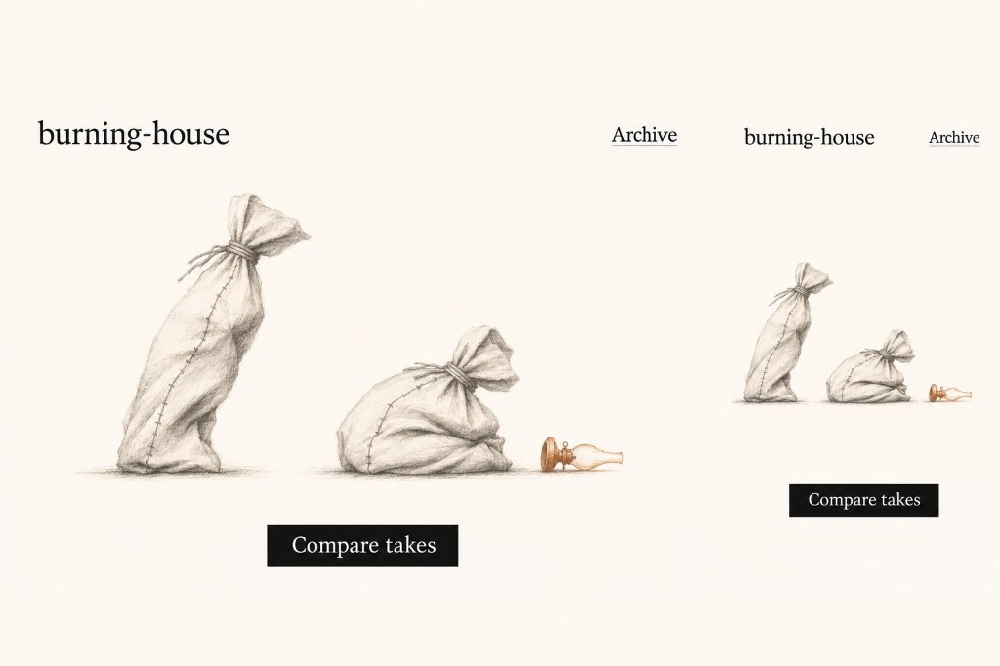
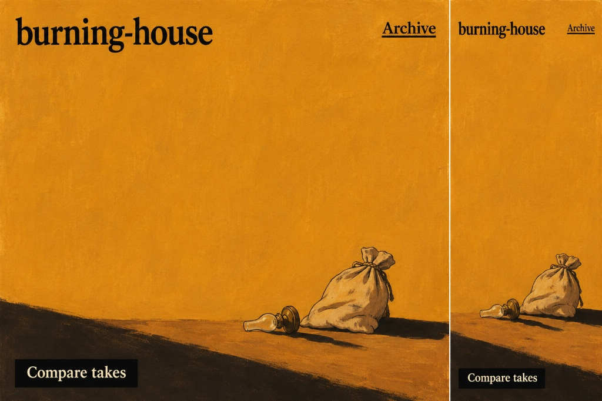

# burning-house

Minimum Viable Video-Text (`VTX-0.1`), faceless canvas flour sacks, research journals, Oulipian/Calvino Zettelkasten, and actuarial anticombinatorics after Italo Calvino's *The Burning of the Abominable House* (1973).

| Paper Plate (`?plate=paper`) | Ochre Plate (`?plate=ochre`) |
| :---: | :---: |
|  |  |

## Entry Points

- **Landing Page & Complete Visual Archive:** [`index.html`](./index.html)
- **Compare Takes (VTX-0.1 Blinded Perceptual Gate & A/B Workbench):** [`vtx01_build/viewer/index.html`](./vtx01_build/viewer/index.html)
- **Journal Toward a Paper (38 Entries, Ruled Notebook):** [`Abominable_House_Journal_38/index.html`](./Abominable_House_Journal_38/index.html)
- **Journal Toward a Paper (20 Entries, Second Pass):** [`journal-20/index.html`](./journal-20/index.html)
- **Presentation Slide Deck:** [`slides/index.html`](./slides/index.html)
- **Typeset Working Paper (PDF):** [`Anticombinatory Forensic Report (1).pdf`](./Anticombinatory%20Forensic%20Report%20%281%29.pdf)

---

## Complete Repository Index (77 Tracked Files)

### Interactive

| File | Size | Description |
| :--- | ---: | :--- |
| [`Abominable_House_Journal_38/index.html`](./Abominable_House_Journal_38/index.html) | `71.9 KB` | Journal Toward a Paper (38 entries, third pass): ruled notebook edition joining DH2025, VTX-0.1, Lab 7, and zettle.md. |
| [`index.html`](./index.html) | `59.0 KB` | Root visual landing page (Paper & Ochre flour-sack plates), synchronized A/B take comparison, and complete repository archive. |
| [`journal-20/index.html`](./journal-20/index.html) | `37.1 KB` | Journal Toward a Paper (20 entries, second pass): original ruled notebook edition unpacked for direct browser reading. |
| [`slides/index.html`](./slides/index.html) | `36.7 KB` | Abominable House presentation slide deck unpacked for direct browser viewing. |
| [`vtx01_build/viewer/index.html`](./vtx01_build/viewer/index.html) | `20.1 KB` | Interactive VTX-0.1 workbench: Tab 1 Blinded Perceptual Gate (no labels), Tab 2 A/B Over-the-Shoulder Inspector, Tab 3 JSON Remix. |

### Films & Plates

| File | Size | Description |
| :--- | ---: | :--- |
| [`Abominable_House_Journal_38/journal-img/02-22.5.jpg`](./Abominable_House_Journal_38/journal-img/02-22.5.jpg) | `47.3 KB` | PAE-03 Flour Tower still (SCION 02 Reiniger silhouette film at 22.5 s): mid-air sack with penny in orange lamp room. |
| [`Abominable_House_Journal_38/journal-img/07-4.1.jpg`](./Abominable_House_Journal_38/journal-img/07-4.1.jpg) | `15.8 KB` | PAE-03 Flour Tower still (SCION 07 Foldès film at 4.1 s): line-drawn sack, flour block, and red-outlined knife. |
| [`Abominable_House_Journal_38/journal-img/08.jpg`](./Abominable_House_Journal_38/journal-img/08.jpg) | `47.5 KB` | PAE-04 Deed VIII (Assault): theatrical curtain matte withholding interior geometry behind threshold slits. |
| [`Abominable_House_Journal_38/journal-img/24-rev1-bowtie.jpg`](./Abominable_House_Journal_38/journal-img/24-rev1-bowtie.jpg) | `65.7 KB` | VTX-0.1 Rev 1 rejected diagnostic crop (f=118 & f=324): 163 px lamp miss in Case A and bow-tie ear-crossing in Case B. |
| [`Abominable_House_Journal_38/journal-img/25-rev2-pair.jpg`](./Abominable_House_Journal_38/journal-img/25-rev2-pair.jpg) | `106.2 KB` | VTX-0.1 Rev 2 accepted paired crop (f=118 & f=324): accidental waist brush & propped door vs. deliberate strike & hall wedge. |
| [`Abominable_House_Journal_38/journal-img/conseq-07-tying.jpg`](./Abominable_House_Journal_38/journal-img/conseq-07-tying.jpg) | `59.5 KB` | PAE-04 Deed VII consequence plate: rope mark persisting on victim sack across subsequent rooms. |
| [`assets/hero-ochre-room.jpg`](./assets/hero-ochre-room.jpg) | `133.0 KB` | Clean amber-ochre gouache plate: tied flour sack, fallen oil lamp, and long diagonal floor shadow. |
| [`assets/hero-paper-sacks.jpg`](./assets/hero-paper-sacks.jpg) | `36.7 KB` | Clean rag-paper illustration plate: two tied canvas flour sacks beside a fallen brass-and-glass oil lamp. |
| [`assets/plate-ochre-reference.jpg`](./assets/plate-ochre-reference.jpg) | `186.4 KB` | Desktop and mobile typographic reference sheet for the Ochre edition. |
| [`assets/plate-paper-reference.jpg`](./assets/plate-paper-reference.jpg) | `63.5 KB` | Desktop and mobile typographic reference sheet for the Paper edition. |
| [`assets/thumbs/thumb-dh2025-packet.jpg`](./assets/thumbs/thumb-dh2025-packet.jpg) | `55.0 KB` | First-page preview plate rendered from DH2025_Concrete_Papers_Packet.pdf. |
| [`assets/thumbs/thumb-forensic-report.jpg`](./assets/thumbs/thumb-forensic-report.jpg) | `214.1 KB` | First-page preview plate rendered from Anticombinatory Forensic Report (1).pdf. |
| [`assets/thumbs/thumb-genesis-2993.jpg`](./assets/thumbs/thumb-genesis-2993.jpg) | `60.6 KB` | Cover preview plate rendered from Berkman (2017), Genesis 45 (genesis-2993.pdf). |
| [`journal-20/journal-img/02-22.5.jpg`](./journal-20/journal-img/02-22.5.jpg) | `47.3 KB` | 20-entry journal copy of SCION 02 Reiniger still at 22.5 s. |
| [`journal-20/journal-img/07-4.1.jpg`](./journal-20/journal-img/07-4.1.jpg) | `15.8 KB` | 20-entry journal copy of SCION 07 Foldès still at 4.1 s. |
| [`journal-20/journal-img/08.jpg`](./journal-20/journal-img/08.jpg) | `47.5 KB` | 20-entry journal copy of PAE-04 Deed VIII curtain still. |
| [`journal-20/journal-img/conseq-07-tying.jpg`](./journal-20/journal-img/conseq-07-tying.jpg) | `59.5 KB` | 20-entry journal copy of PAE-04 Deed VII rope consequence still. |
| [`slides/journal-img/02-22.5.jpg`](./slides/journal-img/02-22.5.jpg) | `47.3 KB` | Slide deck copy of SCION 02 Reiniger still at 22.5 s. |
| [`slides/journal-img/07-4.1.jpg`](./slides/journal-img/07-4.1.jpg) | `15.8 KB` | Slide deck copy of SCION 07 Foldès still at 4.1 s. |
| [`vtx01_build/revisions/rev1_rejected/ab_focus_comparison_rev1_rejected.png`](./vtx01_build/revisions/rev1_rejected/ab_focus_comparison_rev1_rejected.png) | `985.4 KB` | Rejected Rev 1 A/B comparison sheet exposing the lamp miss and bow-tie self-intersection. |
| [`vtx01_build/revisions/rev1_rejected/case_a_rev1_rejected.mp4`](./vtx01_build/revisions/rev1_rejected/case_a_rev1_rejected.mp4) | `1.2 MB` | Rejected Rev 1 Take A MP4 preserved for audit: leaping sack misses lamp by 163 px. |
| [`vtx01_build/revisions/rev1_rejected/case_b_rev1_rejected.mp4`](./vtx01_build/revisions/rev1_rejected/case_b_rev1_rejected.mp4) | `1.1 MB` | Rejected Rev 1 Take B MP4 preserved for audit: fleeing sack corners cross spine into a bow-tie ribbon at f=324. |
| [`vtx01_build/revisions/rev1_rejected/inspection_sheet_case_a_rev1_rejected.png`](./vtx01_build/revisions/rev1_rejected/inspection_sheet_case_a_rev1_rejected.png) | `477.8 KB` | 16-frame contact sheet of rejected Rev 1 Take A. |
| [`vtx01_build/revisions/rev1_rejected/inspection_sheet_case_b_rev1_rejected.png`](./vtx01_build/revisions/rev1_rejected/inspection_sheet_case_b_rev1_rejected.png) | `476.3 KB` | 16-frame contact sheet of rejected Rev 1 Take B. |
| [`vtx01_build/revisions/rev2_accepted/ab_focus_comparison_rev2_accepted.png`](./vtx01_build/revisions/rev2_accepted/ab_focus_comparison_rev2_accepted.png) | `995.7 KB` | High-resolution A/B focus comparison sheet at key frames (f=48, 92, 118, 136, 227, 228, 288, 324, 355). |
| [`vtx01_build/revisions/rev2_accepted/ab_paired_clean_rev2_accepted.mp4`](./vtx01_build/revisions/rev2_accepted/ab_paired_clean_rev2_accepted.mp4) | `1.4 MB` | Side-by-side clean MP4 pairing Take A and Take B across all 384 frames with zero spoiler captions. |
| [`vtx01_build/revisions/rev2_accepted/carry_73frames_case_a_rev2_accepted.png`](./vtx01_build/revisions/rev2_accepted/carry_73frames_case_a_rev2_accepted.png) | `1.3 MB` | 73-frame carried-object continuity proof sheet for Take A (wooden wedge attachment error = 0.00 px). |
| [`vtx01_build/revisions/rev2_accepted/carry_73frames_case_b_rev2_accepted.png`](./vtx01_build/revisions/rev2_accepted/carry_73frames_case_b_rev2_accepted.png) | `1.4 MB` | 73-frame carried-object continuity proof sheet for Take B (wooden wedge attachment error = 0.00 px). |
| [`vtx01_build/revisions/rev2_accepted/case_a_rev2_accepted.mp4`](./vtx01_build/revisions/rev2_accepted/case_a_rev2_accepted.mp4) | `1.1 MB` | Accepted Take A MP4 (16.0 s, 384 frames, 24 fps): Sack A reaches to steady Sack B, brushes lamp, props door from inside. |
| [`vtx01_build/revisions/rev2_accepted/case_b_rev2_accepted.mp4`](./vtx01_build/revisions/rev2_accepted/case_b_rev2_accepted.mp4) | `1.1 MB` | Accepted Take B MP4 (16.0 s, 384 frames, 24 fps): single-line goal patch—Sack A strikes lamp; Sack B wedges door from hall. |
| [`vtx01_build/revisions/rev2_accepted/inspection_sheet_case_a_rev2_accepted.png`](./vtx01_build/revisions/rev2_accepted/inspection_sheet_case_a_rev2_accepted.png) | `471.5 KB` | 16-frame contact sheet across full 16 s timeline of accepted Take A. |
| [`vtx01_build/revisions/rev2_accepted/inspection_sheet_case_b_rev2_accepted.png`](./vtx01_build/revisions/rev2_accepted/inspection_sheet_case_b_rev2_accepted.png) | `469.0 KB` | 16-frame contact sheet across full 16 s timeline of accepted Take B. |

### Papers & Notes

| File | Size | Description |
| :--- | ---: | :--- |
| [`Abominable_House_Framing_Notes.md`](./Abominable_House_Framing_Notes.md) | `28.7 KB` | Framing notes linking Oulipian anticombinatorics, Disney flour-sack tests, Scion version control, BDI/Park memory, and Lem's bitistics. |
| [`abominable_house_mvvt_research_notes.md`](./abominable_house_mvvt_research_notes.md) | `26.7 KB` | Early working notes toward a Minimum Viable Video-Text format. |
| [`Abominable_House_Submission_Draft.md`](./Abominable_House_Submission_Draft.md) | `34.0 KB` | Full Digital Humanities conference submission draft on Calvino's 1973 house, flour-sack flattening, and actuarial anticombinatorics. |
| [`Anticombinatory Forensic Report (1).pdf`](./Anticombinatory%20Forensic%20Report%20%281%29.pdf) | `266.4 KB` | 11-page typeset working paper: MVVT / VTX-0.1, 27:25 Pierazzo prime lock, 14,000 carry slip, −4.6 pp Šeļa confound, and 11/16 CP-SAT proof. |
| [`Flour_Sack_Video_Text_Research_Notes.docx`](./Flour_Sack_Video_Text_Research_Notes.docx) | `45.7 KB` | Word manuscript packet of the Flour Sack Video-Text research notes. |
| [`Logline_Journal_Entries_and_Existing_Assets.md`](./Logline_Journal_Entries_and_Existing_Assets.md) | `40.3 KB` | Project loglines across five registers, Journal Entries 21–38, and audit of existing Lab 7, PAE-03/04, and zettle.md assets. |
| [`p1.md`](./p1.md) | `23.5 KB` | SCION v1.1 XML system instruction for Minimum Viable Video-Text research (NOTES vs. BUILD epistemic boundaries). |
| [`pae04_abominable_house_scion_run.md`](./pae04_abominable_house_scion_run.md) | `42.4 KB` | Recorded SCION run log containing exact BigInt checks on 12^12 and the 8,874,296,672,256 carry-slip factorization. |
| [`README.md`](./README.md) | `17.4 KB` | Repository overview, visual plates, quick links, and complete hyperlinked directory manifest. |
| [`scion_mvvt_abominable_house_instruction.md`](./scion_mvvt_abominable_house_instruction.md) | `28.8 KB` | Companion SCION research instruction and prompt specification for the Abominable House suite. |
| [`VTX01_MVVT_Research_Memo_and_Spec.md`](./VTX01_MVVT_Research_Memo_and_Spec.md) | `40.0 KB` | Approved SCION v1.1 working research memo and concrete VTX-0.1 experiment specification (chance, memory, consequence). |

### Zettels & Sources

| File | Size | Description |
| :--- | ---: | :--- |
| [`DH2025_Concrete_Papers_and_Works_Cited.md`](./DH2025_Concrete_Papers_and_Works_Cited.md) | `283.8 KB` | Curated concrete papers, exact page locators, and Works Cited forged from the DH2025 Lisbon Book of Abstracts. |
| [`DH2025_Concrete_Papers_Packet.pdf`](./DH2025_Concrete_Papers_Packet.pdf) | `39.9 MB` | 39.9 MB extracted PDF packet of the core DH2025 papers cited across the Abominable House research. |
| [`genesis-2993.pdf`](./genesis-2993.pdf) | `705.2 KB` | Natalie Berkman (2017), Genesis 45: archival vs. invented Oulipo-Greimasian genesis of Calvino's Si par une nuit d'hiver un voyageur. |
| [`xzet.md`](./xzet.md) | `48.5 KB` | Clean 509-line five-card slice (ZTL-CALVINO-BLOW-M01..M05): magic objects, Barthes reality effect, Origin of the Birds, Dantès vs. Faria, Bartleby. |
| [`zettle.md`](./zettle.md) | `637.1 KB` | 6,717-line Zettelkasten (68 blocks, 26 distinct cards: M01–M05, G01–G05, R01–R07, 2017-01..09) on Calvino, Jonathan Blow, Oulipo, and AI. |
| [`BoA_DH2025.pdf` (Zenodo DOI)](https://doi.org/10.5281/zenodo.19494802) | `507.4 MB` | Full DH2025 Lisbon Book of Abstracts source volume (exceeds GitHub 100 MB single-file limit; extracted 19-paper packet [`DH2025_Concrete_Papers_Packet.pdf`](./DH2025_Concrete_Papers_Packet.pdf) is tracked above). |

### Cases, Traces & Code

| File | Size | Description |
| :--- | ---: | :--- |
| [`.gitignore`](./.gitignore) | `275 B` | Excludes macOS .DS_Store and the 507 MB BoA_DH2025.pdf raw proceedings blob (cited via Zenodo DOI 10.5281/zenodo.19494802). |
| [`.nojekyll`](./.nojekyll) | `0 B` | GitHub Pages directive serving all folders, filenames with spaces/parentheses, and JSON/JS assets verbatim. |
| [`vtx01_build/cases/case_a_assist.vtx.json`](./vtx01_build/cases/case_a_assist.vtx.json) | `12.3 KB` | Baseline VTX-0.1 scene file: goal 'assist_steadying' with fixed exogenous jolt (18 N) and shared camera. |
| [`vtx01_build/cases/case_b_deliberate.vtx.json`](./vtx01_build/cases/case_b_deliberate.vtx.json) | `13.6 KB` | Counterfactual VTX-0.1 scene file derived from Case A via single-root goal change. |
| [`vtx01_build/cases/patch_a_to_b_goal.json`](./vtx01_build/cases/patch_a_to_b_goal.json) | `5.7 KB` | Explicit JSON patch flipping E2_root_action.goal and 46 permitted downstream consequences. |
| [`vtx01_build/cases/policies_synthetic_p1_p4.json`](./vtx01_build/cases/policies_synthetic_p1_p4.json) | `2.1 KB` | Four synthetic insurance test clauses (P1 fire, P2 accidental tip, P3 deliberate strike, P4 two-channel corroboration). |
| [`vtx01_build/cases/protocols_followup_specs.json`](./vtx01_build/cases/protocols_followup_specs.json) | `2.6 KB` | Follow-up experimental protocols for isolated chance-jolt and focalized-memory comparisons. |
| [`vtx01_build/README.md`](./vtx01_build/README.md) | `6.2 KB` | Build, validation, viewer, and MP4 export documentation for VTX-0.1. |
| [`vtx01_build/revisions/rev1_rejected/validation_report_rev1_failed.json`](./vtx01_build/revisions/rev1_rejected/validation_report_rev1_failed.json) | `2.6 KB` | Validator failure output rejecting Rev 1 on lamp contact distance (163 px) and 37% area loss. |
| [`vtx01_build/revisions/rev2_accepted/verification_record.json`](./vtx01_build/revisions/rev2_accepted/verification_record.json) | `7.2 KB` | Machine-verified Rev 2 acceptance certificate (0 volume drift, 0 foot-slide, 77 identical prefix frames, 46 authorized diff paths). |
| [`vtx01_build/src/build_viewer_bundle.js`](./vtx01_build/src/build_viewer_bundle.js) | `880 B` | Packs VTX JSON cases and policies into viewer/bundle_data.js. |
| [`vtx01_build/src/export_mp4.py`](./vtx01_build/src/export_mp4.py) | `14.4 KB` | Renders deterministic 24 fps MP4 takes and PNG contact/carry proof sheets via Pillow + ffmpeg. |
| [`vtx01_build/src/validate_vtx.js`](./vtx01_build/src/validate_vtx.js) | `10.7 KB` | Automated invariant gate checking volume hold, foot contact, carry lock, cut continuity, and patch whitelist. |
| [`vtx01_build/src/vtx_engine.js`](./vtx01_build/src/vtx_engine.js) | `49.0 KB` | Deterministic 2D flour-sack kinematics, area-preserving deformation, depth-sorted doorway occlusion, and policy engine. |
| [`vtx01_build/traces/chance_trace.json`](./vtx01_build/traces/chance_trace.json) | `957 B` | Recorded exogenous disturbance trace held invariant across Case A and Case B. |
| [`vtx01_build/traces/consequence_trace.json`](./vtx01_build/traces/consequence_trace.json) | `7.7 KB` | Frame-indexed physical and spatial consequence persistence trace across the shot cut (f=227 -> f=228). |
| [`vtx01_build/traces/memory_trace.json`](./vtx01_build/traces/memory_trace.json) | `6.8 KB` | Three-level memory trace separating world marks, Sack A/B recollections, and build logs. |
| [`vtx01_build/traces/policy_traces.json`](./vtx01_build/traces/policy_traces.json) | `3.8 KB` | Dual-column policy verdicts comparing omniscient World State against Camera Evidence (UNKNOWN without witness ballot). |
| [`vtx01_build/traces/validation_report.json`](./vtx01_build/traces/validation_report.json) | `2.6 KB` | Accepted Rev 2 geometric, causal, and diff-whitelist validation report. |
| [`vtx01_build/traces/validation_report_rev1_failed.json`](./vtx01_build/traces/validation_report_rev1_failed.json) | `2.6 KB` | Archived copy of Rev 1 failed validation report in traces/. |
| [`vtx01_build/viewer/bundle_data.js`](./vtx01_build/viewer/bundle_data.js) | `27.0 KB` | Pre-bundled Case A, single-root JSON patch, and synthetic P1–P4 policy clauses for zero-server local & GitHub Pages playback. |

### Bundles

| File | Size | Description |
| :--- | ---: | :--- |
| [`Abominable House Journal.zip`](./Abominable%20House%20Journal.zip) | `207.7 KB` | Original 20-entry ruled notebook zip archive. |
| [`Abominable House Slides.zip`](./Abominable%20House%20Slides.zip) | `100.1 KB` | Original presentation slide deck zip archive. |
| [`Abominable_House_Journal_38.zip`](./Abominable_House_Journal_38.zip) | `322.5 KB` | Portable zip archive of the 38-entry ruled notebook HTML and all six embedded exhibit images. |
